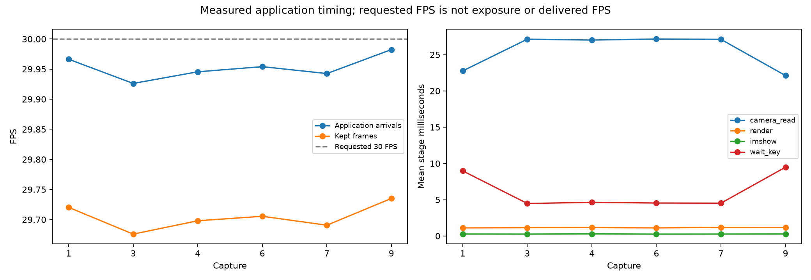

# Capture timing and fixed-normalization diagnostic — 2026-11-14

## Question and frozen reference

The earlier ME/WE investigation found that changing the capture window altered
model predictions, but also refitted clip normalization. The user subsequently
clarified that WE was misunderstood in both sessions; the WE results are excluded.
It also measured retained
FPS below the dataset rate. This follow-up separates those effects without
training or changing the frozen models, normalizer, limiter or application default.
All 15 labels continue competing. Expected labels enter reports after inference.

Current checkpoint SHA256:
`34b766c393cf20a77b001004376195e60ffb58943d7b1f9661bd23edbab81c91`.
The original temporal comparator has the identical GRU backbone.

## Preflight and controls

The unsampled diagnostic adapter reproduces the frozen preprocessor and actual
prepared inputs exactly at float16 precision on all **37 audited ME/WE clips**.
Prefix/envelope refits also reproduce the original implementation. Input arrays
and all protected videos, raw/prepared features, source files, checkpoints and
the selected archive remain unchanged. This is separate diagnostic code; the
production normalizer is not edited. [Preflight evidence](assets/timing-normalization-preflight-2026-11-14.json).

The live protocol is ME, WE, PLEASE three times, four-second automatic capture,
sign once in the first two seconds, then relax. Each capture is observed once
for recognition. Compare full capture, separately normalized prefix/envelope,
and those SAME raw-frame windows cut from full-context normalized features.
Cropping always precedes independent 128-frame selection, preserving the same
raw frame IDs within each matched window. Geometry is recomputed from each
actual input. Full-context preprocessing includes future frames relative to a
prefix: this is retrospective analysis, not a proposed streaming normalizer.
Refits can also change short-gap interpolation or slot initialization, so mask
differences and scale medians are reported alongside feature differences.

Frame-arrival and keep/drop traces exist in RAM only. Saved aggregates cover
interval quantiles/histograms, camera read, predecision/copy, rendering, imshow,
waitKey and loop times, limiter credit, long-gap resets and exact decision
replay. These are application delivery times, not camera exposure timestamps.
No frames are duplicated, no limiter rule is changed, and no live media,
landmark arrays, hidden vectors or raw timing traces are saved.
Tests and preprocessing verification finish BEFORE the live test to avoid
introducing test-run CPU load during physical capture.

## Results

Session `pronoun-timing-live-20261114-121755`; 6 confirmed captures; 3 excluded/unconfirmed.

**User correction:** WE captures 2, 5 and 8 are excluded because the gesture was misunderstood. They are not model errors on verified WE signs. ME and PLEASE remain confirmed. [Correction ledger](assets/pronoun-gesture-feedback-correction-2026-11-14.json).

| Control | ME | WE | PLEASE |
| --- | --- | --- | --- |
| full/current | 1/3 | excluded | 2/3 |
| full/original_temporal_model | 0/3 | excluded | 0/3 |
| first_two_seconds/current | 0/3 | excluded | 3/3 |
| first_two_seconds/original_temporal_model | 0/3 | excluded | 0/3 |
| first_two_seconds_fixed_normalization/current | 0/3 | excluded | 3/3 |
| first_two_seconds_fixed_normalization/original_temporal_model | 0/3 | excluded | 0/3 |
| detected_hand_envelope/current | 0/3 | excluded | 2/3 |
| detected_hand_envelope/original_temporal_model | 0/3 | excluded | 0/3 |
| detected_hand_envelope_fixed_normalization/current | 0/3 | excluded | 2/3 |
| detected_hand_envelope_fixed_normalization/original_temporal_model | 0/3 | excluded | 0/3 |

| Capture | Sign | Source FPS | Kept FPS | Drops | Long gaps | Drops near gaps | Read p50 ms | Render p50 ms | Show p50 ms | Key p50 ms |
| --- | --- | --- | --- | --- | --- | --- | --- | --- | --- | --- |
| 1 | ME | 29.97 | 29.72 | 1 | 0 | 0 | 22.00 | 1.07 | 0.22 | 8.47 |
| 3 | PLEASE | 29.93 | 29.68 | 1 | 0 | 0 | 28.33 | 1.08 | 0.21 | 4.10 |
| 4 | ME | 29.95 | 29.70 | 1 | 0 | 0 | 27.10 | 1.08 | 0.22 | 4.40 |
| 6 | PLEASE | 29.95 | 29.71 | 1 | 0 | 0 | 27.58 | 1.08 | 0.22 | 4.19 |
| 7 | ME | 29.94 | 29.69 | 1 | 0 | 0 | 27.24 | 1.10 | 0.21 | 4.03 |
| 9 | PLEASE | 29.98 | 29.74 | 1 | 0 | 0 | 22.22 | 1.13 | 0.22 | 9.45 |

| Capture | Margin | Window | Total | GRU | Geometry | Bias |
| --- | --- | --- | --- | --- | --- | --- |
| 1 | WE minus ME | full | 2.4098 | 0.7541 | 0.9788 | 0.6769 |
| 1 | WE minus ME | first_two_seconds | 3.4358 | 1.6798 | 1.0790 | 0.6769 |
| 1 | WE minus ME | first_two_seconds_fixed_normalization | 3.2670 | 1.6113 | 0.9788 | 0.6769 |
| 3 | MY minus PLEASE | full | -0.8497 | 1.8461 | -3.0153 | 0.3195 |
| 3 | MY minus PLEASE | first_two_seconds | -2.3039 | 0.4389 | -3.0623 | 0.3195 |
| 3 | MY minus PLEASE | first_two_seconds_fixed_normalization | -2.2804 | 0.4172 | -3.0171 | 0.3195 |
| 4 | WE minus ME | full | -0.0062 | -0.0559 | -0.6273 | 0.6769 |
| 4 | WE minus ME | first_two_seconds | 0.2287 | 0.4724 | -0.9206 | 0.6769 |
| 4 | WE minus ME | first_two_seconds_fixed_normalization | 0.5233 | 0.4737 | -0.6273 | 0.6769 |
| 6 | MY minus PLEASE | full | 0.3608 | 2.0348 | -1.9935 | 0.3195 |
| 6 | MY minus PLEASE | first_two_seconds | -0.0354 | 1.5582 | -1.9131 | 0.3195 |
| 6 | MY minus PLEASE | first_two_seconds_fixed_normalization | -0.0248 | 1.5685 | -1.9128 | 0.3195 |
| 7 | WE minus ME | full | 0.0938 | 0.3358 | -0.9189 | 0.6769 |
| 7 | WE minus ME | first_two_seconds | 0.6633 | 0.8926 | -0.9062 | 0.6769 |
| 7 | WE minus ME | first_two_seconds_fixed_normalization | 0.6291 | 0.8711 | -0.9189 | 0.6769 |
| 9 | MY minus PLEASE | full | -1.1058 | 1.1348 | -2.5601 | 0.3195 |
| 9 | MY minus PLEASE | first_two_seconds | -1.4559 | 0.7758 | -2.5511 | 0.3195 |
| 9 | MY minus PLEASE | first_two_seconds_fixed_normalization | -1.4746 | 0.7548 | -2.5489 | 0.3195 |

## Corrected findings

WE recognition accuracy is **not measured** in these sessions: the user withdrew those gesture labels. Valid ME/PLEASE captures remain analyzable.

The instrumented session retained **29.68–29.74 FPS**. There were **6 limiter drops across the six valid captures**, no long-gap resets, and zero replay mismatches. The earlier 14–18 FPS behavior was not reproduced. ME still scores 1/3 at approximately 30 FPS, so low FPS is not necessary for these new ME errors. This does not identify the cause of the earlier slow session.

Prefix refitting versus full-context-fixed normalization gives the same first guess in **6/6 matched valid captures**. Both give ME 0/3 and PLEASE 3/3, versus full-window ME 1/3 and PLEASE 2/3. Feature magnitudes change, but prefix masks agree exactly in these six captures. Holding normalization fixed does not repair ME here; nor is a fixed short crop a blanket fix.

In ME capture #1, both the pooled recurrent and geometry branches favor WE. In #7, geometry favors ME, but recurrent evidence plus bias outweigh it by a small margin. No single branch intervention is established as a general remedy. The exact cause of the five historical ME failures remains unverified because their sequences were never saved.

**Next:** compare correctly performed ME and WE against the public dataset references, then collect a small explicitly validated comparison before further model tuning. Do not use the excluded WE motions as training data or as evidence that WE recognition failed.

## Interpretation boundaries and reproducibility

Full versus fixed-normalization prefix isolates window selection with full
per-frame preprocessing held fixed; it still recalculates clip geometry.
Fixed versus refitted prefix compares preprocessing context on matched frames.
Branch logit contributions locate which representation changes; a prediction
flip is not automatically a valid repair. A 30-FPS request does not establish
camera exposure rate. Replay identifies deterministic limiter effects on the
observed delivery trace, not why the camera/UI produced that trace.

Run `scripts/verify_timing_normalization.py` once for the immutable preflight;
use `scripts/diagnose_pronouns_live.py --timing-normalization --report NEW_PATH`
for a new diagnostic; summarize using `scripts/report_capture_timing.py --live
PATH`. Add `--confirm-all` only after explicit user confirmation of all prompts.
The portable [results JSON](assets/capture-timing-normalization-2026-11-14.json)
contains the full aggregate evidence. Earlier sessions and reports are preserved.

Repository checks: **168 tests passed**, with lockfile, compilation and dependency checks.
