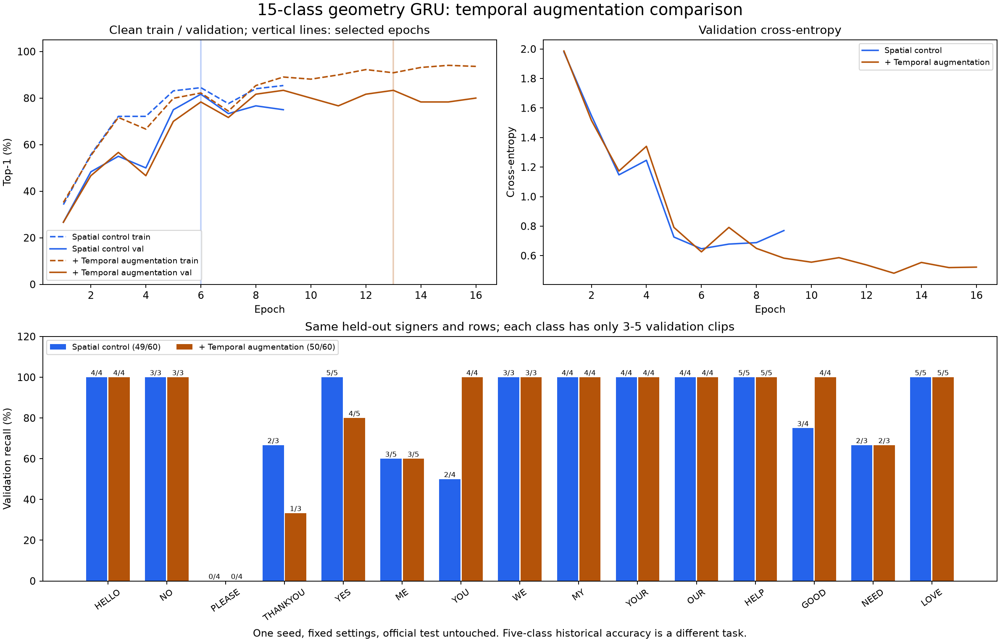

# Fifteen-sign geometry GRU with temporal augmentation

The user authorized temporal augmentation and ten additional classes,
including pronouns. Available dataset labels were checked before selecting:

- Existing: HELLO, NO, PLEASE, THANKYOU, YES (IDs 0-4 preserved).
- Added: ME, YOU, WE, MY, YOUR, OUR, HELP, GOOD, NEED, LOVE (IDs 5-14).

ME is the intended pronoun label, not a fingerspelled letter I. Dataset glosses
are retained as provided; the selection does not establish that all signs are
visually unambiguous in arbitrary conversational contexts. MY/YOUR/OUR are
possessive forms. No synthetic class or synonym relabeling is introduced.

## Prespecified experiment

1. Build a separate train/validation subset from existing prepared landmarks,
   preserving official signer separation and all selected examples. Verify
   source prepared-shard checksums for every copied row and preprocessing
   identity. Original arrays are read-only. No original videos or MediaPipe
   re-extraction, no cleaning, no test reads/copies/evaluation.
2. Train two new 15-class GRU + geometry models from scratch: matched control
   with existing spatial augmentation, and candidate with temporal augmentation
   added. Same initialized weights/buffers, seed 42, two layers x 256 units,
   mean pooling, 254 sequence channels and 17 clip summaries, dropout .5,
   AdamW .001, weight decay .001, batch four, two loader workers, CUDA AMP and
   the existing cuDNN workaround. No five-class checkpoint is overwritten or
   used to initialize the new 15-output heads.
3. Keep the existing 28-epoch cap and validation-only early stopping / small-gap
   selection policy. Both clean train and validation passes are unaugmented.
   No search or webcam-based parameter selection.
4. Temporal augmentation is on the extracted normalized sequences, not RGB:
   a 20% identity chance, otherwise a .85-1.15 sequence-length factor on the
   hand-present envelope. Existing leading/trailing hand-absent spans may
   independently change length by .5-1.5 with probability .5. These spans are
   tracking proxies, not confirmed neutral rest or action boundaries.
5. Sample nearest original frames in order; preserve endpoints of each
   nonempty pre/active/post span, masks and coordinate tuples. No reversal,
   shuffled time, interpolated coordinates/masks or invented neutral poses.
   Shorter inputs can repeat frames; total output remains at most 128 frames.
   Slowing a capped sequence may be limited by this budget. Missing-hand
   sequences are retained unchanged. Existing cached downsampling cannot be
   undone by augmentation.
6. Ordering: temporal sampling in training collation -> existing spatial
   perturbation -> GRU input and recomputation of the 17 summaries from those
   exact frames. The user's ordering question is resolved by distinguishing
   cached per-frame coordinates from final clip-level summaries: the latter
   must describe the actual augmented sequence. Clip summaries have no time
   axis to augment afterward. Fit frozen median/mean/scale values on original
   training clips only; keep validation and webcam normalization unchanged.
7. Compare paired validation accuracy, macro F1, top five and per-class recall.
   A larger vocabulary makes the task harder; compare candidate against the
   matched 15-class control rather than directly attributing differences from
   the old five-class scores to augmentation.

Paths:

- Subset: `data/training/asl-fifteen-signs-128-v1`.
- Runs: `models/asl-gru-fifteen-signs-temporal-v1/{control,temporal}`.
- Source snapshots/configurations/all epochs are retained. Previous models,
  probe pickles and source caches are verified unchanged after training.
- Existing recognition loader accepts the same architecture with 15 labels;
  evaluation disables training collation/augmentation. Default remains the
  previous configuration pending a deliberate field test.

```powershell
.\.venv\Scripts\python.exe -u scripts/run_fifteen_sign_temporal_trial.py
```

## Completed results

The subset contains **219 training clips / 28 signers** and **60 validation
clips / five other signers**. Both models have 792,078 trainable parameters
and identical hashed initial states, including the frozen geometry statistics.
No missing geometry values occurred in original training inputs. All examples
were retained. Training finished on the local RTX 4060 without changing prior
weights/probes, the new subset, or the verified parent source chunks.

| Selected-checkpoint metric | Spatial control | Temporal candidate |
| --- | ---: | ---: |
| Selected epoch | 6 | 13 |
| Completed epochs | 9 | 16 |
| Stop reason | Validation-loss patience | Validation-loss patience |
| Clean training | 185/219 (84.47%) | 199/219 (90.87%) |
| Validation top-1 | 49/60 (81.67%) | 50/60 (83.33%) |
| Validation macro F1 | 0.7899 | 0.8014 |
| Validation cross-entropy | 0.6467 | 0.4809 |
| Validation top-five | 60/60 | 59/60 |
| Absolute clean train/validation gap | 2.81 percentage points | 7.53 percentage points |
| Training/selection time | 88.73 seconds | 151.67 seconds |

These timings exclude source verification/preparation and final rescoring.
The candidate completed more epochs; total time is not a pure augmentation
overhead measurement. Each run had two initial recoverable AMP overflows,
skipping those optimizer updates and reducing the gradient scale to 16384.
No sustained numerical failure occurred.

| Label | Train / val clips | Control val correct | Temporal val correct |
| --- | ---: | ---: | ---: |
| HELLO | 14 / 4 | 4/4 | 4/4 |
| NO | 16 / 3 | 3/3 | 3/3 |
| PLEASE | 14 / 4 | 0/4 | 0/4 |
| THANKYOU | 16 / 3 | 2/3 | 1/3 |
| YES | 15 / 5 | 5/5 | 4/5 |
| ME | 13 / 5 | 3/5 | 3/5 |
| YOU | 15 / 4 | 2/4 | 4/4 |
| WE | 16 / 3 | 3/3 | 3/3 |
| MY | 13 / 4 | 4/4 | 4/4 |
| YOUR | 16 / 4 | 4/4 | 4/4 |
| OUR | 15 / 4 | 4/4 | 4/4 |
| HELP | 13 / 5 | 5/5 | 5/5 |
| GOOD | 15 / 4 | 3/4 | 4/4 |
| NEED | 15 / 3 | 2/3 | 2/3 |
| LOVE | 13 / 5 | 5/5 | 5/5 |

## Interpretation

Temporal augmentation corrected four control errors and regressed three
previously correct validation clips: **one net additional correct clip**.
The matched comparison supports a modest result, not a reliable general gain
from augmentation. The candidate has lower validation loss but a larger
accuracy gap and slightly lower top-five accuracy. One seed and just 3-5
validation examples per label limit conclusions.

Both models confuse all four validation PLEASE examples with MY. Their
training PLEASE recall is 3/14 for the selected control and 10/14 for the
temporal candidate, so the candidate has learned that class on some training
examples but does not generalize on these validation clips. ME is confused
with WE twice. These are model errors, not confirmed dataset mislabels; no
clips were removed or relabeled. The improved YOU and GOOD results coexist
with YES/THANKYOU regressions. The 15-class expansion introduces competition
absent from the five-class pilot; the previous 10/10 webcam session does not
validate this expanded recognizer.

## Model and workflows

Inference is **webcam -> MediaPipe Hands/Pose -> normalized [T<=128,254]
sequence -> parallel packed two-layer GRU and 17 geometry summaries -> masked
mean/dropout [256] plus standardized geometry [17] -> concatenate [273] ->
Linear(273,15) -> label mapping/text**. The linear head has 4,110 parameters;
the full recognizer has 792,078. MediaPipe weights remain frozen and separate.

Training uses the same branches, preceded by training-only temporal collation
(candidate) and existing spatial augmentation. Geometry is recomputed after
those transforms, then the GRU and head are updated jointly using cross-entropy,
backpropagation and AdamW. Fixed geometric calculations are not differentiated.
Validation and webcam inference use no augmentation or parameter updates.

Both selected checkpoints restored through `SignRecognizer` on CUDA with the
correct 15-label order. All 60 validation score vectors per run matched their
frozen reports exactly (maximum difference 0.0). This verifies runtime loading,
not fresh 15-class webcam performance; no webcam test was run in this step.

## Saved artifacts

- [Full paired report, provenance, curves and decisions](assets/fifteen-sign-temporal-2026-11-12.json)
- [Learning curves and class recall](assets/fifteen-sign-temporal-2026-11-12.png)
- [Confusion matrices](assets/fifteen-sign-temporal-2026-11-12-confusion.png)
- Selected candidate: `models/asl-gru-fifteen-signs-temporal-v1/temporal/best.pt`,
  SHA256 `0921e10a193044e5cbc92e29b386b370b827431b6850f0bc49f6e64ea4441843`.
- Selected control: `models/asl-gru-fifteen-signs-temporal-v1/control/best.pt`,
  SHA256 `9f570f70c92675c2d5d2671662acec3809ad33c7a326ae7c700d0223fbc254f6`.



The project check passed **133 tests**, compilation, offline lockfile validation
and dependency imports before training. Seven new tests cover source integrity,
split preservation, temporal ordering/endpoints/masks/caps, seeded collation,
clean evaluation behavior, 15-output gradients and recomputation of geometry
from the actual augmented frames. Previous five-class models/defaults remain
unchanged. New weights are separate local artifacts, outside the earlier archive;
no push, new archive or official test evaluation was performed.

## Notebook update and final verification

The user additionally requested an explanation of the final architecture and
an updated notebook. Reporting notebooks 01 and 02 now begin with the current
two-branch architecture diagram, tensor dimensions, 17 measurement names,
training/inference ordering and limitations. Notebook 02 includes the frozen
paired curves, per-class counts and confusion matrices; historical full-vocabulary
results remain clearly separate. The saved notebooks are actual executed
read-only reports, not training notebooks or fabricated execution outputs.

- [02: architecture, training and results](../notebooks/02_model_training_and_evaluation.ipynb)
- [01: workflow and investigation](../notebooks/01_project_workflow_and_investigation.ipynb)
- Companion snapshot: `notebooks/artifacts/experiment_snapshot.json`.
- Exported PNGs and byte hashes: `notebooks/artifacts/report_manifest.json`.

The final project check passed **134 tests**, including a new execution test
for the architecture/curve/confusion cells and their read-only behavior.
Notebook 01 has eight executed code cells/five figures; notebook 02 has
17 executed code cells/15 figures. All 23 manifest entries match their byte
hashes, and both notebooks reference the correct snapshot SHA256. The
architecture and per-class figures were visually reviewed. Notebook 03 and
its dataset-distribution snapshot/manifest were preserved unchanged. Rebuilding
these reports performed no training, extraction, camera capture or weight update.

## Subsequent PLEASE/MY investigation

The user subsequently authorized a bounded
[PLEASE versus MY video/trajectory audit](please-my-trajectory-2026-11-12.md).
All 35 train/validation sources decoded and matched raw-to-prepared features
exactly at cache precision. All four failed validation PLEASE examples retain
their circular wrist paths and all source frames (each has at most 128 frames).
PLEASE is second behind MY in every case. Exploratory path-shape measurements
support a motion-representation/weighting investigation, not a claim that the
circle disappeared in extraction or that sources are mislabeled. No new model,
re-extraction, cleaning or routing change followed that diagnostic.
