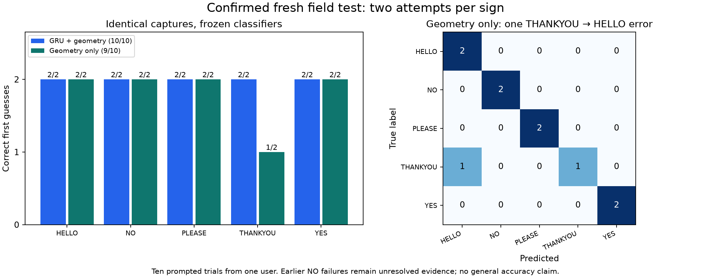

# Fresh all-five-sign geometry-only field comparison

The user requested a new webcam test after the fixed geometry-only classifier
scored 18/19 on validation and 6/6 on previously inspected NO/HELLO summaries.
This session compares fresh prompted captures; it is not training data.

## Fixed protocol

- Prompts: HELLO, THANKYOU, PLEASE, YES, NO, then repeat. Two attempts per sign,
  ten captures total. Space starts each prompt; a 1.5-second countdown precedes
  automatic four-second capture. Sign once, then relax; no ending key press.
- Primary comparison: frozen geometry-only logistic regression on CPU versus
  frozen epoch-8 mean-pool GRU + geometry on CUDA. Existing pooled-control
  and candidate geometry-off predictions are also retained as diagnostics.
- One MediaPipe observation/normalization pass per capture, shared by all
  models. The probe receives the same 17 scalar summaries that the candidate
  derives from the normalized sequence. No expected label enters inference.
- Only mirror the preview. Keep the existing unmirrored inputs, cache precision,
  normalization, true sequence length and 128-frame cap. Capture limit 30 FPS.
- Do not fit, recalibrate or tune after seeing live results. No model/default
  change. These are tiny single-user diagnostic samples, not general accuracy.
- Save predictions, prompted-label rank, timing, aggregate tracking counts and
  scalar hand measurements. No images, video, coordinate arrays or embeddings.
  The camera closes after ten attempts; Q permits cancelling early.
- Verify original checkpoint/probe files unchanged on exit. User confirmation
  of normal completion is required before assigning performance numbers.

## Runtime verification

`GeometryProbe` checks the local artifact's configuration, feature/label schema,
source hashes and model SHA256 before restoring its fitted pipeline. Training
imputation and scaling are reused, never refitted on webcam frames.
`scripts/verify_geometry_probe_runtime.py` reproduced all six frozen score
vectors with maximum absolute difference 2.22e-16. No training or camera access
was involved in that verification. The project checks passed **126 tests**,
compilation, offline lockfile validation and dependency imports.

Identities:

- Geometry-only model:
  `models/asl-five-class-geometry-only-v1/model.pkl`, SHA256
  `6ed7a25dc62eb66bb012ae79f070163008cbfb6937ae417278f227d60b1a5e45`.
- GRU + geometry, epoch 8:
  `models/asl-gru-five-signs-geometry-v1/geometry/best.pt`, SHA256
  `6f305835ffbcdc94a8d9cf4ffa989d4977f26e6c2a313a00e9a8e74d1f6fbb07`.
- Pooled control, epoch 4:
  `models/asl-gru-five-signs-geometry-v1/control/best.pt`, SHA256
  `3811868d39942b3962b75926c3bc5b3707c95fc13647bf0ea3a27ab94df4ab33`.

Command:

```powershell
.\.venv\Scripts\python.exe scripts/diagnose_five_sign_live.py --geometry-only-comparison --report .cache/five-class-geometry-live-20261112-01.json
```

The visible header identifies **GEOMETRY ONLY (CPU) vs GRU+GEOMETRY 8 (CUDA)**.
The JSON records both primary model identities and capture IDs. The completed
session and user confirmation are recorded below.

## Confirmed results

The session finished all ten captures and released the camera. The user
confirmed: **Completed all ten; capture was normal**. The confirmation is
stored in the analysis report; the original capture log remains unchanged.
All three model files were verified against session SHA256 identities again
while producing the report.

| Model / diagnostic control | Correct | Macro F1 |
| --- | ---: | ---: |
| Mean-pool GRU control, epoch 4 | 8/10 | 0.7333 |
| GRU + geometry, epoch 8 | **10/10** | **1.0000** |
| Same epoch-8 model with geometry disabled | 8/10 | 0.7333 |
| Geometry-only logistic regression | **9/10** | **0.8933** |

| Sign | GRU + geometry | Geometry only |
| --- | ---: | ---: |
| HELLO | 2/2 | 2/2 |
| THANKYOU | 2/2 | 1/2 |
| PLEASE | 2/2 | 2/2 |
| YES | 2/2 | 2/2 |
| NO | 2/2 | 2/2 |

The geometry-only error was capture **2**, THANKYOU predicted HELLO at 71.62%,
with THANKYOU second at 17.58%. Its other THANKYOU capture (7) was correct at
54.32%. All scores are uncalibrated model outputs, not measured correctness
probabilities.

The pooled GRU control predicted NO on both YES captures (4 and 9). The
GRU + geometry candidate correctly predicted YES at 82.14% and 64.67%.
On NO captures (5 and 10), the full candidate was correct at 82.90% and 80.73%,
whereas disabling its geometry changed both predictions to YES. This is a
direct within-model intervention showing useful geometry contribution in
this session. The geometry-off candidate and separately trained pooled control
have different recurrent/head weights, so their behavior need not match.

## Interpretation and limits

This fresh session supports retaining **GRU + geometry as the leading
experimental candidate**. Geometry-only is a useful diagnostic baseline and
correctly handled YES/NO here; its THANKYOU error and training-only grouped
CV weakness for that class remain relevant. No model replacement, default
change, fitting, threshold change or branch-gain tuning followed these results.

Ten prompted captures from one user, only two per class, do not establish a
reliable general accuracy or prove that the NO problem is fixed. The previous
confirmed six-trial session still contains two NO-to-HELLO errors from the
same epoch-8 checkpoint. The model was not retrained between these sessions.
The older six captures used to design this comparison must not be relabeled
as fresh validation or discarded because this session succeeded.

Current capture FPS was 29.23-29.74, with shoulder anchors throughout. NO hand
coverage was 48.3% and 43.3%, compared with 94.9%, 100% and 55.8% in the previous
NO/HELLO session. These differences are consistent with capture/timing or pose
sensitivity being worth investigating, but are observational: no controlled
timing intervention was performed, and presence counts do not establish joint
accuracy. Do not turn them into a hand-visibility threshold or require the
user to hide their hands to force a label.

The next useful evaluation is a prespecified comparison across capture timing,
sign duration and additional signers, keeping both successful and failed
attempts. No more architecture changes are justified solely by this small
successful session.

## Saved evidence

- [Confirmed session, identities, confusion matrices and predictions](assets/five-class-geometry-field-test-2026-11-12.json)
- [Standalone figure](assets/five-class-geometry-field-test-2026-11-12.png)
- Reporter: `scripts/report_geometry_field_test.py`; validates complete prompts,
  capture IDs, shared observations, prediction outcomes and model hashes.



The reporter completed successfully, compiled, and its figure was visually
reviewed. This reporting step ran no training or model inference. Only scalar
measurements and predictions were retained; no media, coordinates or embeddings.
