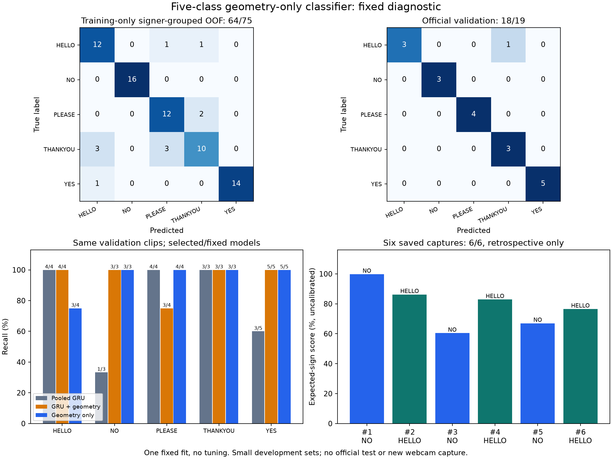

# Five-class geometry-only control

The user authorized this offline control after the same-capture diagnostic
showed geometry helping NO but being outweighed by the recurrent/head
contribution on two captures. This step tests whether those same 17 scalar
hand-shape and motion-excursion measurements can separate all five labels
without a recurrent branch. It does not change the webcam recognizer.

## Protocol recorded before fitting

- Five labels: HELLO, NO, PLEASE, THANKYOU, YES. Preserve all 75 official
  training clips and 19 validation clips, including signer separation.
- Use exactly the previous 17 scalar measurements; no joint coordinates,
  participant IDs, file names, expected labels, duration or presence fractions
  as classifier inputs. These summarize motion as well as hand shape; this
  is not a single-frame classifier.
- Fixed CPU multinomial logistic regression, L2 regularization, C=1, lbfgs,
  2000-iteration maximum, seed 42. Train-only median imputation, optional
  missingness indicators and standardization. No tuning or augmentation.
  Missing-hand clips are retained with training-median imputation.
- Three signer-grouped folds within training, with preprocessing fitted afresh
  per fold; then fit one final model on all training clips and evaluate the
  official validation set. Treat convergence warnings as failures.
- Freeze the fit before scoring the six confirmed, previously inspected live
  scalar summaries. They influenced the diagnostic design, so their results
  are retrospective evidence, not an independent webcam benchmark. They
  contain only NO and HELLO inputs despite five possible outputs.
- No official test reads, new webcam capture, retraining of the GRU, routing,
  branch-weight adjustment or default change. Preserve source caches and prior
  weights/probes by SHA256. New model stays local at
  `models/asl-five-class-geometry-only-v1/model.pkl` and is outside old archives.

```powershell
.\.venv\Scripts\python.exe scripts/run_five_class_geometry_probe.py
```

## Results

The fixed classifier completed on CPU, converging in 28 solver iterations.
The three cross-validation fits plus final fit and dataset scoring took about
0.10 seconds, excluding dependency startup, feature summarization and artifact
verification. There are 90 fitted coefficients/intercepts (5 x 17 + 5).
There were no missing geometry values or insufficient clips in either split;
all 75/19 examples were retained. Training had 24 signers; validation had four
other signers. Preprocessing was refitted within every grouped training fold.

| Evaluation | Correct | Top-1 | Macro F1 |
| --- | ---: | ---: | ---: |
| Training fit | 72/75 | 96.00% | 0.9599 |
| Training-only signer-grouped out-of-fold | 64/75 | 85.33% | 0.8510 |
| Official validation | 18/19 | 94.74% | 0.9429 |

Held-out fold sizes were 23, 27 and 25, with 21, 21 and 22 correct predictions.
Across grouped out-of-fold predictions, NO was correct on 16/16, YES 14/15,
HELLO 12/14, PLEASE 12/14 and THANKYOU 10/16. This highlights a remaining
THANKYOU generalization weakness despite the small validation set's good score.

Validation predictions were HELLO 3/4, NO 3/3, PLEASE 4/4, THANKYOU 3/3, YES
5/5. The single error was `16493550450776628-HELLO.mp4` (P39), predicted THANKYOU.
The GRU + geometry candidate also scored 18/19 on these same validation rows,
but its error was a different PLEASE clip. Equal aggregate accuracy does not
mean identical strengths or general reliability.

## Previously confirmed live captures

The model was frozen before loading these six scalar summaries. The original
live report confirms that the user followed all prompts with normal capture.

| Capture | Intended | Pooled control | GRU + geometry | Geometry only |
| --- | --- | --- | --- | --- |
| 1 | NO | HELLO | HELLO | NO |
| 2 | HELLO | HELLO | HELLO | HELLO |
| 3 | NO | HELLO | HELLO | NO |
| 4 | HELLO | HELLO | HELLO | HELLO |
| 5 | NO | NO | NO | NO |
| 6 | HELLO | HELLO | HELLO | HELLO |

Geometry-only scored **6/6** (3/3 NO and 3/3 HELLO); both sequence models scored
4/6. All five labels were available as outputs. NO scores for captures 1, 3
and 5 were 99.78%, 60.39% and 66.99%; HELLO scores were 86.22%, 82.86% and
76.51%. These are uncalibrated scores, not correctness probabilities.

This is **retrospective, design-informed evidence**, not a new independent
webcam test: the errors motivated the feature/control design, and only two
intended classes appear in this set. No live scalars were used for fitting or
parameter selection. The report retains F1 averaged across all five fixed
labels (0.4 with absent classes assigned zero), and separately F1 over the
two present classes (1.0); neither should be advertised as a fresh five-class
webcam benchmark.

## Interpretation

The earlier failed NO captures retain enough of the selected geometric
measurements for this fixed five-class classifier to label them correctly,
even with HELLO as a competing output. Combined with the previous within-model
intervention, this supports a representation/fusion/learning issue rather
than complete loss of distinguishing geometry on these captures. It does not
prove all joints are accurate or establish why the GRU representation favors
HELLO. The geometry-only classifier also summarizes motion ranges and angles;
its success does not imply temporal information is unnecessary for ASL.

The next useful step is a fresh, prompted all-five-sign webcam comparison of
the frozen geometry-only model against the GRU + geometry candidate before
changing defaults or deciding how to combine branches. No additional model
variants were fitted, no branch scaling was tuned and no automatic routing
was installed in this step.

## Artifacts

- [Complete metrics, fold assignments and predictions](assets/five-class-geometry-only-2026-11-12.json)
- [Standalone figure](assets/five-class-geometry-only-2026-11-12.png)
- Model/configuration/source snapshot:
  `models/asl-five-class-geometry-only-v1/` (local, outside previous archives).

Existing checkpoints/probes and eight train/validation cache files were
verified unchanged by SHA256. Official test files and the webcam were not
opened. Only load the saved pickle if it is a trusted local artifact.
Model SHA256:
`6ed7a25dc62eb66bb012ae79f070163008cbfb6937ae417278f227d60b1a5e45`.



Regenerate the plot without training or rescoring:

```powershell
.\.venv\Scripts\python.exe scripts/report_five_class_geometry_probe.py
```

## Verification

`scripts/check.ps1` passed the offline lockfile check, source compilation,
all **124 tests**, and dependency imports. Three added tests cover fixed
feature extraction with missing clips, five-label metric order and invalid
probabilities, and grouped signer separation with fold-training-only scaling.
The saved figure was rendered and visually reviewed. Reports preserve all
individual predictions and fold assignments; no dataset examples were removed
because of model errors. No Git push or archive update was performed.

## Subsequent fresh webcam comparison

The user subsequently completed and confirmed a fresh ten-trial
[all-five-sign comparison](five-class-geometry-field-test-2026-11-12.md).
The frozen geometry-only classifier scored 9/10 (one THANKYOU predicted HELLO),
while the unchanged GRU + geometry candidate scored 10/10. Both recognized
both YES and both NO attempts. These small single-user results do not establish
general accuracy or negate earlier NO failures. Both models remain preserved;
no recognition default was changed.
