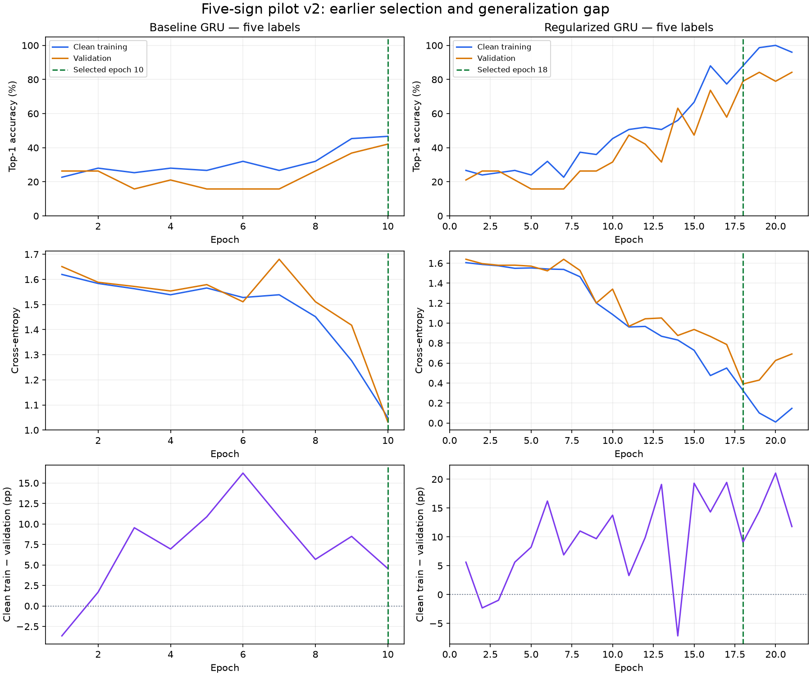

# Five-sign pilot with earlier epoch selection

## Supervisor-directed change — 11 November 2026

The user stopped the video/feature audit and requested (1) five short,
recognizable signs with distinct intended meanings and (2) earlier training
termination / checkpoint selection with a smaller train–validation gap.
No audit or previous training process remained running when checked. The partial
audit was marked stopped at 214/836 shards. Its findings are preserved, and no
cleanup, relabeling or normalization repair is part of this experiment.

## Vocabulary and preserved inputs

Use **HELLO, NO, PLEASE, THANKYOU, YES**: brief standalone gestures, each mapped
to one intended gloss. Avoid the earlier ME/I ambiguity and multi-sign phrases.
This is a small, deliberately distinct vocabulary, not a claim that these are
literally the five shortest recordings among all 2,731 labels. Whole recording
duration includes rest/repetitions and is not an annotation of sign duration.

Keep every existing example of these labels and retain its official split and
participant ID. No random 80/20 repartition, test filtering, video trimming,
changed hand assignment or new feature extraction is performed. The derived
cache copies selected rows and remaps the five target IDs to 0–4:

`data/training/asl-five-signs-128-v1/`

The original `data/training/asl-gru-128-v1/`, raw landmark shards, videos and
full-vocabulary checkpoints remain unchanged. This trains real five-output
classifiers from scratch; it does not merely hide labels of the old models.

## What the previous curves show

| Existing full-vocabulary run | Epoch | Recorded training top-1 | Validation top-1 | Gap |
|---|---:|---:|---:|---:|
| Baseline, proposed earlier | 10 | 58.95% | 48.45% | 10.50 pp |
| Baseline, previously selected minimum CE | 23 | 90.77% | 55.73% | 35.04 pp |
| Regularized, proposed earlier | 28 | 77.43% | 59.20% | 18.23 pp |
| Regularized, previously selected minimum CE | 37 | 87.60% | 61.06% | 26.54 pp |

Earlier epochs reduce the reported gap but sacrifice some validation accuracy.
Only `best.pt` and `last.pt` weights exist for those older runs; epoch JSON files
are metrics, not recoverable epoch-10 / epoch-28 parameters. The older training
numbers also include dropout and, for the regularized run, augmentation. They
are not directly comparable to clean evaluation-mode validation measurements.

## Prespecified new protocol

- Two-layer, 256-unit GRU with five linear outputs; 128-frame / 254-feature inputs.
- RTX 4060, CUDA AMP, native CUDA GRU (cuDNN disabled as in prior GRU runs).
- AdamW, LR 0.001, seed 42, training batch 16, two loader workers per split.
- Baseline: dropout 0.3, weight decay 0.0001; **maximum 10 epochs**.
- Regularized: dropout 0.5, weight decay 0.001, existing ±5° roll / 0.9–1.1 body
  scale augmentation; **maximum 28 epochs**.
- Stop sooner after three epochs without validation CE improvement of at least
  0.001; also stop after three consecutive >10 pp clean accuracy gaps if validation
  accuracy has not improved for three epochs.
- Evaluate the training split again each epoch with dropout/augmentation off.
  Compare this `train_clean` result with validation, rather than treating the
  optimization-time training accuracy as an equivalent measurement.
- Save **every epoch's weights**, metrics and clean gap. Pick an eligible epoch
  within one validation example of the best validation accuracy and within 0.10 CE
  of the minimum loss among accuracy-eligible epochs. Among these, minimize the
  absolute clean accuracy gap, then prefer the earliest epoch. This excludes a
  chance-level tiny-gap epoch when a materially better model exists.
- Freeze both selections before reading either model's test results. Test once
  per selected model, reporting top-1, cross-entropy, macro precision/recall/F1 and
  a five-class confusion matrix. Top-5 is uninformative with five possible labels.

The 10/28 limits are new experiment budgets, not a prediction that a five-class
run learns at the same epoch numbers as a 2,731-class run. Fewer training clips
also mean far fewer optimizer updates per epoch. If this underfits, report that
result rather than silently extending the requested limits.

## Reproduction and artifacts

```powershell
.\.venv\Scripts\python.exe -u scripts/run_five_sign_pilot.py
```

Separate outputs: `models/asl-gru-five-signs-early-v1/{baseline,regularized}/`.
The runner refuses to overwrite existing pilot outputs. Each selected `best.pt`
is compatible with the existing webcam recognizer's explicit `--checkpoint` option.
The webcam default initially remained ST-GCN; after the user's subsequent request
to connect the regularized GRU, it was switched to the five-sign epoch-18 GRU.
Five-class outputs are closed-set guesses and do not establish reliable
rejection of other signs or direct comparability with the old full-vocabulary scores.

Four tests passed for the selection policy, target remapping, signer preservation
and unchanged source files. New modules and launcher compile successfully. The
standalone CUDA check passed (PyTorch 2.11.0+cu128, RTX 4060).

## First pilot result and corrective protocol

The first batch-16 experiment completed and was preserved under `early-v1`.
It underfit: clean training accuracy never exceeded **32%**. The baseline ran
10 epochs, selected 7, and scored 12/60 (20.0%) on test. The regularized model
stopped after 11 epochs, selected 1 under the gap rule, and scored 11/60 (18.3%).
These are diagnostic failures, not recommended models. A small gap does not make
an almost-untrained model useful. The selected epoch-1 result exposes that limit
of gap-based selection when **all** candidate epochs have weak performance.

There are only **75 training / 19 validation / 60 test clips**, from **24 / 4 / 11
distinct signers**. At batch 16 that is five optimizer updates per epoch, versus
628 in the old full-vocabulary runs. Transferring an epoch number without accounting
for this change made the first budget too aggressive.

Before changing code, copied and hash-checked the first pilot's six source modules
and launcher into its local `engine_snapshot/`. The full-vocabulary checkpoint
hashes also remained unchanged after the first pilot.

The next trial is **`models/asl-gru-five-signs-early-v2/`**, using the exact same
subset, labels, seed, architecture, optimizer and 10/28-epoch ceilings:

- Training batch **4**: 19 updates per epoch, maximum 190 / 532 updates. Evaluation
  remains batch 16. This adjustment is based on the observed training underfit,
  not on optimizing the test scores.
- Allow five warm-up epochs and require that clean training accuracy has reached
  50% before plateau/gap stopping can fire. This is an early-stopping activation
  guard, not a claim that 50% is acceptable final accuracy. The hard epoch ceilings
  always apply, and nonfinite losses still abort immediately.
- Keep the same validation-only checkpoint policy and save every epoch. Mark a
  run that never reaches the learning guard as `underfit`.
- The completed subset is reused only after verifying its file checksums; no
  source feature, class example or normalization rule is changed.

The launcher now starts v2 and refuses existing output directories. Six pilot
tests pass, including chance-level plateau handling and warm-up/gap stopping.
## Completed corrective trial

Both selected checkpoints were frozen before either model was tested. Test
evaluation covered all **60 clips / 11 unseen signers** for the five labels.

| Model | Epochs run / cap | Selected epoch | Clean train top-1 | Validation top-1 | Absolute gap | Test top-1 | Test macro F1 |
|---|---:|---:|---:|---:|---:|---:|---:|
| Baseline GRU | 10 / 10 | 10 | 46.67% | 42.11% | 4.56 pp | 41.67% (25/60) | 34.46% |
| Regularized GRU | 21 / 28 | **18** | **88.00%** | **78.95% (15/19)** | **9.05 pp** | **70.00% (42/60)** | **67.24%** |

The baseline still underfits. Its smaller gap does not make it the stronger
recognizer. Both have 789,253 parameters: reducing the head from 2,731 outputs to
five removes parameters, while the two 256-unit recurrent layers remain the same.

The regularized model stopped after three stale validation-loss epochs. Epoch
18 is also the minimum-validation-loss epoch and has a smaller gap than the
subsequent epochs:

| Epoch | Clean train accuracy | Validation accuracy | Accuracy gap | Clean train CE | Validation CE |
|---|---:|---:|---:|---:|---:|
| **18** | **88.00%** | **78.95%** | **9.05 pp** | **0.3255** | **0.3908** |
| 19 | 98.67% | 84.21% | 14.46 pp | 0.1002 | 0.4296 |
| 20 | 100.00% | 78.95% | 21.05 pp | 0.0100 | 0.6264 |
| 21 | 96.00% | 84.21% | 11.79 pp | 0.1467 | 0.6912 |

Epoch 19 gains one validation example but widens the gap and increases validation
loss. The prespecified eligibility/gap rule chooses 18 without using test results.
There are only 19 validation examples, so one prediction changes accuracy by
5.26 percentage points; these are small-pilot results, not precise population estimates.

### Per-sign test performance of the selected regularized model

| Sign | Correct / test clips | Recall |
|---|---:|---:|
| HELLO | 12 / 14 | 85.71% |
| NO | 3 / 11 | 27.27% |
| PLEASE | 7 / 13 | 53.85% |
| THANKYOU | 12 / 12 | 100.00% |
| YES | 8 / 10 | 80.00% |

Seven NO examples become YES; five PLEASE examples become THANKYOU. These
remaining errors must not be hidden by the overall result. Dataset scores do not
establish webcam performance, and these five-class numbers are not directly
comparable with the old 2,731-class test scores.



### Verification and records

- Full lockfile, compilation, dependency and unit checks passed: **73 tests**.
  The audit's pure NumPy fixture tests mock their unused OpenCV dependency to
  avoid initializing native DLLs during discovery; no data audit was restarted.
- Loaded the selected epoch-18 checkpoint through `SignRecognizer`. All **19
  validation clips** produced exactly identical label rankings and scores via
  raw-landmark/live preprocessing and prepared-cache inference: maximum score
  difference **0.0**, checkpoint unchanged. This is a runtime consistency check,
  not a live-camera test. No webcam was opened.
- Original baseline, regularized GRU and ST-GCN checkpoint SHA256 values are
  unchanged before/after both pilot experiments. The full cache and raw landmarks
  remain untouched. All 10 baseline and 21 regularized epoch weight files are kept.
- Training-loop times, including loader startup/evaluation/checkpoint writes:
  baseline **31.28 s**, regularized **59.00 s**; excludes initial CUDA/cache setup
  and final test evaluation. One regularized AMP overflow skipped its update and
  recovered; losses stayed finite.
- Full local results: `models/asl-gru-five-signs-early-v2/report.json`,
  `{baseline,regularized}/epoch-*.{json,pt}`, `test-report.json`,
  `test-predictions.json`, `regularized/runtime-consistency.json`.
- Portable aggregate records: [both trial reports](assets/five-sign-early-pilot-2026-11-11.json).

Selected checkpoint:
`models/asl-gru-five-signs-early-v2/regularized/best.pt`

SHA256: `78b1a4b02ad7ed9118d9b63ee2f9fe0f5c1d91c6c54c66c41e4c18695d18ca7c`.

Explicit command, equivalent to the current default after the user's switch:

```powershell
.\.venv\Scripts\python.exe scripts/recognize_webcam.py --checkpoint models/asl-gru-five-signs-early-v2/regularized/best.pt
```

Expected persistent header: GRU, epoch 18, CUDA, **5 labels**. Recheck runtime
consistency without opening a camera using `scripts/verify_five_sign_runtime.py`.

### Live connection requested after the ST-GCN comparison

Opened session `webcam-gru5-regularized-epoch18-20261111-01` using this exact
checkpoint. Both MODEL_READY and WINDOW_READY report GRU / epoch 18 / CUDA;
the session JSON reports SignGRU, five classes, camera_open=true and the selected
checkpoint SHA256 above. Predictions/timing and aggregate counts are saved to
`.cache/webcam-gru5-regularized-epoch18-20261111-01.json`; video and landmark
coordinates are not saved. No new training ran. The CLI default was switched
to this checkpoint so subsequent bare launches select the same model.

The user subsequently reported NO as the first guess for every sign. The completed
session contains **four captures, all NO**, with softmax scores **80.1–94.3%**;
hands were detected in **343/409 frames**, and body anchors in **409/409**. Those
counts do not verify landmark geometry. Intended labels were not saved per
capture, so formal webcam accuracy is not calculated. The same frozen model's
existing dataset test predictions include NO on only 6/60 clips, so it is not a
globally constant-output classifier. No exclusive cause of the live failure is
established. [Feedback and session measurements](assets/five-sign-gru-live-feedback-2026-11-11.json)
preserve the evidence without images or landmark coordinates.

Those four captures measured **30.45 / 29.87 / 29.36 / 30.24 FPS**. After the
user requested FPS consistency, the webcam retained its best-effort hardware
request and gained an explicit default 30-FPS capture-buffer limiter. It skips
excess frames, preserves timing, avoids duplicates and reports actual FPS. No
normalizer, dataset or model weights changed; the 128-step limit still applies
after capture. The software limiter passes synthetic-stream and camera-loop
checks (81 project tests total), but has not yet been tested on the physical
camera or shown to correct NO-only recognition.

That initial limiter was subsequently found to retain only 15.76–18.09 FPS from
roughly 30-FPS camera delivery in the user's newer ten-capture session (eight NO
first guesses). Windows' coarse monotonic clock and the interval gate caused a
reproducible sampler regression. The clock and sampler are corrected with 84
passing tests. A user-confirmed paired HELLO check retained 29.53 / 27.84 FPS,
but still predicted NO then YES. Hands remained detected in the last ten frames
of both, so the intended no-hand ending was not tested. Targeted training/validation
controls also show sensitivity to hand visibility at clip endings. Neither
finding alone proves the original live cause; no retraining or data cleaning
was performed. See the [investigation and exact evidence](five-sign-no-collapse-investigation-2026-11-11.md).

An additional automatic HELLO session recorded three attempts (NO / YES / NO),
without establishing a full second of no detected hands at the ending. Fresh
video decoding and MediaPipe extraction of all four HELLO validation clips
through the same webcam prediction function gives four correct results and
exactly matches cached scores. No live fix or sole cause is established; source
features and weights remain unchanged. The focused record includes these results.
