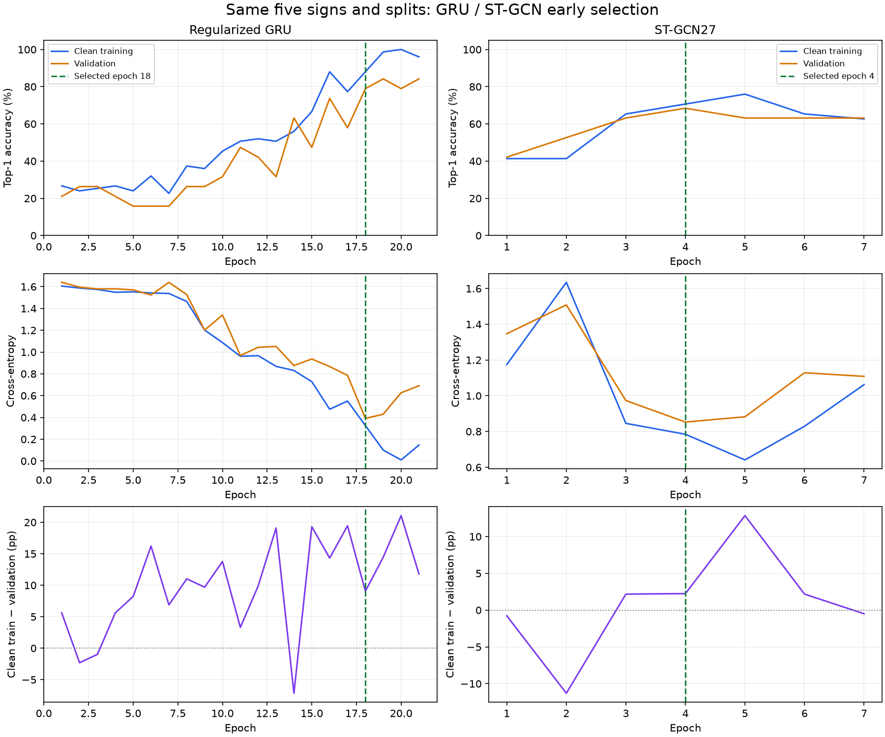
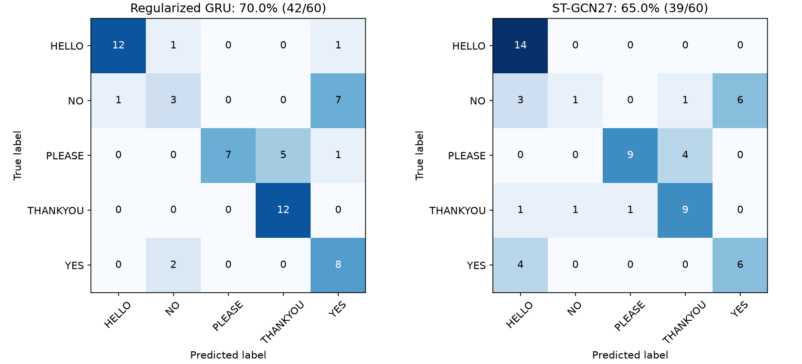

# Five-sign ST-GCN with earlier selection — 11 November 2026

## Request and previous curves

The user requested the same reduced-class, earlier-checkpoint experiment for
ST-GCN, pointing to epochs 32–33 of the old full-vocabulary curve.

| Old 2,731-class epoch | Recorded training top-1 | Validation top-1 | Accuracy gap | Validation CE |
|---|---:|---:|---:|---:|
| 32 | 63.02% | 62.80% | **0.22 pp** | 1.5009 |
| 33 | 64.18% | 61.99% | 2.19 pp | 1.5154 |
| 39 (previously selected) | 75.79% | 67.23% | 8.56 pp | 1.3934 |
| 49 (last) | 86.31% | 68.85% | 17.47 pp | 1.4440 |

Among epochs 25 onward, 32 has the smallest absolute recorded accuracy gap.
However, those training metrics include augmentation, dropout and training-mode
BatchNorm; validation is measured in evaluation mode. They are not matched clean
measurements. Earlier epochs also trade away some validation performance. The
new pilot evaluates both splits in evaluation mode for a comparable gap.

The old run retains only `best.pt` (39) and `last.pt` (49), not epoch-32/33 weights.
Metrics JSON files cannot restore those parameters. Train a separate five-output
model from scratch and save every epoch.

## Prespecified comparison

- Exactly the existing GRU pilot's **HELLO, NO, PLEASE, THANKYOU, YES** subset:
  **75 train / 19 validation / 60 test clips**, **24 / 4 / 11 signers**.
- Reuse `data/training/asl-five-signs-128-v1/` after checksum verification. No
  cleaning, feature extraction, altered normalization or dropped examples.
- Same project ST-GCN27 graph/backbone: 27 XY joints, at most 128 time steps,
  10 graph/temporal blocks, widths 64/128/256 and a five-output linear head.
  The graph representation differs from the GRU's full 254-feature input.
- Existing regularization: dropout 0.5, AdamW LR 0.001 / weight decay 0.001,
  ±5° XY roll and 0.9–1.1 body scale augmentation. Constant LR as in the five-sign
  GRU pilot; the older full-vocabulary ST-GCN used a scheduler.
- Seed 42, training batch 4 (19 updates/epoch), evaluation batch 16, two loading
  workers per training/validation split, RTX 4060 / CUDA AMP, cuDNN convolutions.
- **33-epoch upper limit**, rather than assuming that the smaller task must have
  its optimum at the old run's epoch 32. Evaluate clean training and validation
  each epoch, preserving BatchNorm running statistics during evaluation.
- Reuse the GRU pilot's stopping policy: five-epoch warm-up, a 50% clean-training
  learning guard, then patience 3 / CE minimum improvement 0.001, or a sustained
  >10 pp accuracy gap with three stale validation-accuracy epochs. The hard
  epoch limit always applies.
- Select only with training/validation evidence: within one validation example of
  the best top-1 and 0.10 CE of the best accuracy-eligible loss, choose the smallest
  absolute clean accuracy gap, then the earliest tie. Save every epoch.
- Freeze selection before evaluating all 60 test clips once. Report top-1,
  cross-entropy, macro precision/recall/F1 and per-sign confusion. Top-5 is
  necessarily 100% and is omitted.

The previous five-sign GRU result is already known. The vocabulary and split are
fixed; new settings are not chosen by searching this test set. This is a small
project comparison, not an untouched research benchmark. A small gap without
adequate learning is not a successful recognizer.

## Execution and records

```powershell
.\.venv\Scripts\python.exe -u scripts/run_five_sign_stgcn.py
```

Output: `models/asl-stgcn27-five-signs-early-v1/`. Refuse to overwrite existing
outputs. Reuse the shared pilot engine with an explicit architecture factory;
ST-GCN checkpoints cannot silently instantiate a GRU. The previous GRU pilot's
frozen source snapshots retain its original engine version.

Hash-check the original full-vocabulary ST-GCN/GRU checkpoints, both final GRU
pilot checkpoints and all subset payloads before/after this run. Keep the audit
stopped. No webcam is opened by training or report generation.

## Completed results

Training stopped at **epoch 7**, after three validation-loss epochs without
improvement. The selected checkpoint is **epoch 4**: it has the lowest validation
CE and the highest validation top-1 in this run. Epoch 5 is also selection-eligible,
but has a wider clean accuracy gap. Epoch 7 has a smaller gap while both sets
perform worse; its validation loss excludes it from selection.

| Five-sign model | Selected epoch | Clean train top-1 | Validation top-1 | Absolute gap | Test top-1 | Test macro F1 |
|---|---:|---:|---:|---:|---:|---:|
| Regularized GRU | 18 | 88.00% | 78.95% (15/19) | 9.05 pp | 70.00% (42/60) | 67.24% |
| **ST-GCN27** | **4** | **70.67% (53/75)** | **68.42% (13/19)** | **2.25 pp** | **65.00% (39/60)** | **59.04%** |

The smaller gap did not produce higher accuracy. The difference is three test
clips, from a single seed and a small fixed vocabulary; it does not establish
that one architecture is generally better. There are only 19 validation clips,
so one prediction changes validation accuracy by 5.26 percentage points.

| ST-GCN epoch | Clean train top-1 | Validation top-1 | Signed accuracy gap | Clean train CE | Validation CE |
|---|---:|---:|---:|---:|---:|
| 3 | 65.33% | 63.16% | +2.18 pp | 0.8454 | 0.9731 |
| **4** | **70.67%** | **68.42%** | **+2.25 pp** | **0.7844** | **0.8527** |
| 5 | 76.00% | 63.16% | +12.84 pp | 0.6408 | 0.8823 |
| 6 | 65.33% | 63.16% | +2.18 pp | 0.8292 | 1.1286 |
| 7 | 62.67% | 63.16% | −0.49 pp | 1.0623 | 1.1085 |

The later decline in clean training performance is not sufficient evidence of
ordinary monotonic overfitting; optimization and BatchNorm-statistics variability
can also contribute. No cause was isolated here. The stopping decision follows
the prespecified validation rule rather than asserting a diagnosis.

### Per-sign test comparison

| Sign | Test clips | GRU correct | ST-GCN correct |
|---|---:|---:|---:|
| HELLO | 14 | 12 | **14** |
| NO | 11 | 3 | **1** |
| PLEASE | 13 | 7 | **9** |
| THANKYOU | 12 | 12 | **9** |
| YES | 10 | 8 | **6** |

Six NO examples become YES, and four PLEASE examples become THANKYOU. NO remains
particularly weak and must not be hidden by the overall score. No webcam accuracy
is claimed. A five-class score is not directly comparable with the old 2,731-class
score, and a forced closed-set guess does not reject an unrelated sign.





### Verification and artifacts

- Full project lockfile/compilation/dependency checks and **74 tests passed**.
  A new test verifies explicit ST-GCN construction, five outputs, graph mismatch
  rejection and unchanged BatchNorm buffers during evaluation.
- All **19 validation clips** match cached inference and the raw-landmark/live
  preprocessing path exactly: label rankings identical, maximum probability
  difference **0.0**, checkpoint unchanged. This check did not open the camera.
- Five protected prior checkpoints and all subset payload hashes are unchanged.
  The audit remains stopped, and no source videos, landmarks or normalization
  rules were changed. Original GRU engine snapshots remain available.
- The model has **3,087,583 parameters**. Its training loop took **20.38 seconds**,
  including loading-worker startup, clean evaluations and checkpoint writes,
  excluding initial CUDA/cache checks and final test evaluation. Three initial
  AMP optimizer updates were skipped while the scale recovered; all later
  epochs had zero skipped updates and all losses were finite.
- All seven epoch checkpoints, selection receipt, frozen engine source, test
  predictions/confusion and runtime measurements are kept locally in
  `models/asl-stgcn27-five-signs-early-v1/`.
- [Portable results and old epoch-32/33 records](assets/five-sign-stgcn-2026-11-11.json)
  include the exact same-test-row check against the GRU.

Selected checkpoint SHA256:
`62f273158ac19e4d211704290c3b6a4229a16894f39d6f915863d75f210ee05f`.

### Explicit webcam selection

```powershell
.\.venv\Scripts\python.exe scripts/recognize_webcam.py --checkpoint models/asl-stgcn27-five-signs-early-v1/best.pt
```

Expected header: **ST-GCN, epoch 4, CUDA, 5 labels**. Following the user's later
request to connect the regularized GRU, the bare CLI now selects that five-sign
epoch-18 GRU. Use the explicit argument above for this ST-GCN pilot. No ST-GCN
webcam was opened as part of this experiment.

Recheck the runtime path without opening a camera:

```powershell
.\.venv\Scripts\python.exe scripts/verify_five_sign_runtime.py --checkpoint models/asl-stgcn27-five-signs-early-v1/best.pt
```
