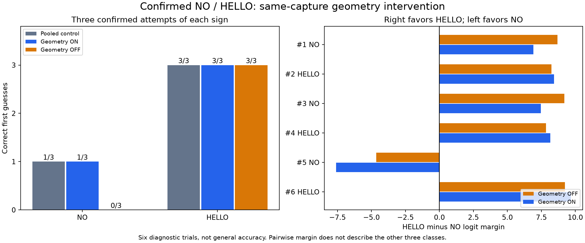

# Same-capture NO/HELLO geometry diagnostic

The user reported that the epoch-8 geometry-augmented mean-pool GRU improved
HELLO, THANKYOU, PLEASE and intermittently YES, while NO could produce HELLO
at approximately 99.8% with NO second. Capture numbers for that feedback were
not supplied, so historical predictions are not assigned new ground truth.
The user then authorized this controlled comparison.

## Protocol

- Prompts: NO, HELLO, NO, HELLO, NO, HELLO. Press Space once for each prompt;
  wait for SIGN NOW; perform the sign once, then relax. Automatic four-second
  capture avoids a keyboard action at the end. No adjustment to sign technique
  or artificial input transformations is introduced.
- Detect hands/pose and normalize exactly once per capture, preserving the
  float16-cache precision and 128-frame maximum. Feed the identical sequence
  to the frozen epoch-4 pooled control and epoch-8 geometry candidate.
- Score the same candidate again with its standardized geometry inputs set to
  zero. This is an intervention on its trained head, not the control model.
- Record top-five scores, prompted-label rank, correct/incorrect outcome,
  timing and aggregate tracking counts. Softmax scores are uncalibrated.
- For HELLO minus NO, report the full-model logit margin, geometry-disabled
  margin, their difference, and FP32 recurrent / geometry / bias contributions.
  Positive favors HELLO; negative favors NO. Record the decomposition residual
  because CUDA AMP rounds head computations. The FP32 decomposition should
  not be described as bitwise identical to AMP arithmetic.
- Persist only scalar hand measurements and each feature's standardized value
  and HELLO-minus-NO contribution. Coordinate arrays, classifier input vectors,
  embeddings, still images and videos remain unsaved. All live arrays stay in
  RAM until the inference finishes. No training or test-split evaluation.
- Save checkpoint identities and verify both files unchanged on exit.
  The user must confirm they followed the prompts before reporting accuracy.

Output: `.cache/gru-geometry-guided-20261112-01.json`. The completed,
user-confirmed findings are recorded below.

```powershell
.\.venv\Scripts\python.exe scripts/diagnose_five_sign_live.py --geometry-comparison --report .cache/gru-geometry-guided-20261112-01.json
```

## Verification

The shared guided driver retains its existing modes. New tests cover the
no-bank geometry mode, six automatic captures, ordered timing, camera release,
both checkpoint identities and JSON-only outputs. A fixed synthetic model
checks that disabling geometry changes the winner and margin as expected,
that the prompt label never affects inference, that hooks are removed and
weights stay unchanged. It also rejects different training-cache identities.
The complete project check passed **121 tests**, compilation, offline lockfile
validation and dependency imports. These are implementation checks, not live
recognition results.

## Confirmed results

The session completed all six captures, released the camera, and verified both
checkpoint files unchanged. The user confirmed: **Completed all six; capture
was normal**. Confirmation is stored in the portable analysis report; the
original capture log is preserved without edits.

| Capture | Prompt | Pooled control | Geometry ON | Geometry OFF |
| --- | --- | --- | --- | --- |
| 1 | NO | HELLO | HELLO | HELLO |
| 2 | HELLO | HELLO | HELLO | HELLO |
| 3 | NO | HELLO | HELLO | HELLO |
| 4 | HELLO | HELLO | HELLO | HELLO |
| 5 | NO | NO | NO | YES |
| 6 | HELLO | HELLO | HELLO | HELLO |

The control and full candidate each scored **4/6**, comprising 1/3 NO and
3/3 HELLO. With geometry disabled, the same candidate scored **3/6**, with
0/3 NO and 3/3 HELLO. These six prompted trials are a diagnostic, not an
estimate of general webcam accuracy or an improvement across five classes.

## What the intervention establishes

On the two failed NO captures, the recurrent representation and its learned
classifier weights strongly favored HELLO. The explicit geometry branch
shifted the HELLO-versus-NO margin toward NO, but not enough to reverse it:

| NO capture | Margin with geometry OFF | Geometry effect | Margin with geometry ON |
| --- | ---: | ---: | ---: |
| 1 | +8.686 | -1.765 | +6.921 |
| 3 | +9.196 | -1.740 | +7.455 |
| 5 | -4.652 | -2.955 | -7.607 |

Positive favors HELLO and negative favors NO. These are measured logit margins,
not probabilities. The first failed candidate prediction was HELLO 99.875%
versus NO 0.0985%; the second was HELLO 99.877% versus NO 0.0578%. A second-place
NO therefore did not mean a close decision. The geometry effect favored NO
over HELLO on **all three NO trials**.

The classifier bias contributed only +0.1036 toward HELLO. FP32 recurrent
contributions for failed NO attempts were +8.5845 and +9.0889, versus geometry
contributions of -1.7655 and -1.7384. Their discrepancy from actual AMP outputs
was at most 0.001413 across all trials, far smaller than those margins.
Thus a dominant additive bias or AMP rounding is an inadequate explanation
of these two HELLO-versus-NO decisions.

On capture 5, geometry changed the overall winner from **YES to NO**, raising
NO's softmax score from 38.28% to 62.95%. The HELLO-minus-NO margin alone cannot
describe that YES/NO competition; the recorded full five-class scores establish
the change. This confirms useful geometry contribution on that capture; it
does not prove a geometry-only five-class classifier would be reliable.

## What remains uncertain

This identifies a decision mechanism on these captures: GRU-derived features
and head weights overrule a useful geometry signal on captures 1 and 3. It
does not establish why that recurrent contribution favors HELLO: input pose,
sign timing, training coverage, model shortcut learning and tracking estimates
remain possible contributors. No joint-coordinate accuracy claim is made.

NO hand coverage was 94.9%, 100%, and 55.8% for captures 1, 3 and 5; the correct
capture had no detected hands in its final quarter. The first failed capture
also ended without a detected hand in its final frame. Hence a single missing
hand at the ending is not a sufficient separator, and the coverage association
is not a controlled causal timing result. Capture FPS remained approximately
29.2-29.7 with body anchors present throughout; no gross frame-rate collapse
or absent-body-anchor failure was observed. Detector presence counts do not
prove correct joint locations.

A useful next offline control is a **five-class geometry-only classifier**:
fit it on the 75 official training clips, evaluate validation separately, and
then score these frozen, design-informed live scalar summaries. The earlier
binary NO/YES probe did not test competition with HELLO. This would test whether
the geometry can distinguish all five labels before changing fusion weights,
adding an auxiliary loss or introducing another architecture. No such new
training, manual branch scaling or threshold change was done in this step.

## Saved evidence

- [Confirmed session and computed summary](assets/gru-geometry-guided-2026-11-12.json)
- [Standalone diagnostic figure](assets/gru-geometry-guided-2026-11-12.png)
- `scripts/report_geometry_guided_check.py` validates completed prompts, shared
  captures, outcomes and checkpoint-integrity flags before producing the report.



No live media, coordinate arrays or embeddings were retained. No model training
or official test evaluation took place, and no recognition default changed.

## Subsequent offline control

The user subsequently authorized the proposed
[five-class geometry-only classifier](five-class-geometry-only-2026-11-12.md).
The fixed, training-only logistic regression scored 64/75 in signer-grouped
out-of-fold evaluation, 18/19 validation and 6/6 on these frozen retrospective
live summaries (3/3 NO and 3/3 HELLO). It was not fitted on live examples.
This further supports useful distinguishing geometry on the failed captures,
without establishing fresh all-five-sign webcam performance. The main GRU
models and application defaults remain unchanged.
