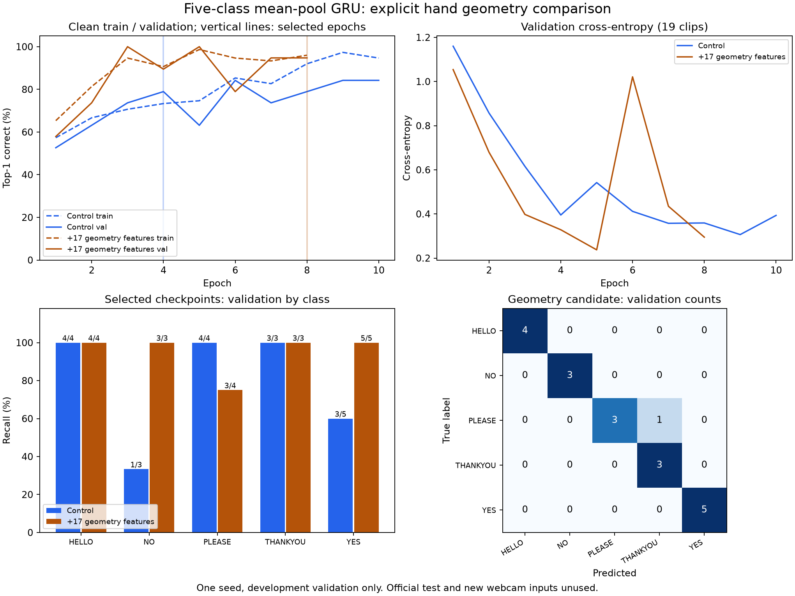

# Step 2: explicit hand geometry in the five-class mean-pool GRU

Authorized after the separate YES/NO probe. This experiment asks whether
explicit hand geometry improves the actual five-class task, where HELLO,
PLEASE and THANKYOU compete with NO and YES. Binary-probe accuracy is not a
five-class result.

## Fixed protocol (written before training)

- Retain the same 75 training and 19 official validation clips and signer
  separation. No official test files or new webcam inputs are used.
- Train a fresh mean-pool GRU control and a geometry-augmented mean-pool GRU
  from scratch. Both retain the original 254-channel GRU input, two 256-unit
  layers, 128-frame maximum, real-length mean pooling, dropout .5, AdamW .001,
  weight decay .001, batch four, two loader workers, seed 42, CUDA AMP and
  existing roll/scale augmentation. Keep the existing 28-epoch maximum,
  stopping rules and validation-only small-gap checkpoint selection policy.
- Candidate: concatenate the same 17 scalar measurements from step 1 to the
  256 pooled/dropout outputs, then learn one five-output linear classifier.
  Exactly 85 extra trainable weights, no extra hidden layer. Geometry inputs
  do not pass through dropout; the recurrent path retains existing dropout.
- Initial GRU and original classifier weights match the control; 85 new
  geometry weights start at zero. Constructor RNG state is preserved so the
  initialization itself cannot alter the control's dropout/shuffle stream.
- Fit imputation medians, means and population standard deviations on all 75
  training rows only. Store them as frozen checkpoint buffers. Missing values
  use training medians; fully missing columns use zero, constant scales use
  one. Missing-hand clips are retained. No labels, participant IDs, durations
  or presence fractions enter this branch.
- Recompute geometry from the actual augmented frames during training to
  keep both input paths consistent. Measurement uses the existing CPU NumPy
  code; GRU/head forward and backward use CUDA. This fixed measurement branch
  is nondifferentiable, while the GRU remains differentiable. Inference uses
  exactly the same summary and frozen training statistics.
- Preserve all epochs and old weights. Output is separate at
  `models/asl-gru-five-signs-geometry-v1/{control,geometry}`. No default or
  webcam runtime change during training. The new architecture was an offline
  experiment at this stage; subsequent webcam integration is recorded below.
- After selecting checkpoints without test data, compare per-class validation
  recall, confusion, macro F1 and paired errors. Also zero the candidate's
  standardized geometry branch as an ablation; this does not recreate the
  separately trained control. Verify whether the fresh control reproduces
  the historical mean-pool checkpoint tensors.
- One seed, one fixed configuration, no search. The repeatedly used small
  validation set is development evidence, not a new independent benchmark.

```powershell
.\.venv\Scripts\python.exe -u scripts/run_gru_geometry_trial.py
```

## Results

Both runs completed on the local RTX 4060. The repeated control selected epoch
4 after ten epochs and reproduced **every model tensor** from the historical
mean-pool GRU checkpoint exactly. The candidate stopped after eight epochs
because validation loss had not improved for three epochs. The unchanged
selection policy selected epoch **8**:

| Selected-checkpoint metric | Control | Geometry candidate |
| --- | ---: | ---: |
| Parameters | 789,253 | 789,338 |
| Selected epoch | 4 | 8 |
| Clean training correct | 55/75 (73.33%) | 72/75 (96.00%) |
| Validation correct | 15/19 (78.95%) | 18/19 (94.74%) |
| Validation macro F1 | 0.7867 | 0.9429 |
| Validation cross-entropy | 0.3952 | 0.2948 |
| Absolute clean train/validation accuracy gap | 5.61 percentage points | 1.26 percentage points |
| Training/selection time, excluding final rescoring | 40.47 s | 32.89 s |

The candidate achieved 19/19 validation accuracy at epochs 3 and 5. Epoch 8
was retained because the prespecified policy permits one fewer correct
validation example, requires competitive validation loss, then chooses the
smallest absolute train/validation accuracy gap. Eligible epochs were 5 and
8; epoch 8's gap was slightly smaller. No checkpoint was substituted after
inspecting the per-class results. The epoch-5 checkpoint remains preserved.
Candidate runtime was shorter because it completed fewer epochs; this is not
evidence that adding CPU geometry makes an epoch faster.

| Validation class | Control correct | Geometry correct |
| --- | ---: | ---: |
| HELLO | 4/4 | 4/4 |
| NO | 1/3 | 3/3 |
| PLEASE | 4/4 | 3/4 |
| THANKYOU | 3/3 | 3/3 |
| YES | 3/5 | 5/5 |

Four previous validation mistakes were corrected, all in NO/YES. One previously
correct PLEASE example, `05859480723249688-PLEASE.mp4` from P26, became
THANKYOU. This marks a model mistake, not a confirmed annotation problem.



## Geometry-branch ablation

On the same selected candidate, replacing its standardized geometry vector
with zero reduced validation accuracy from **18/19 to 14/19**. NO changed
from 3/3 to 2/3 and YES from 5/5 to 2/5. Thus the learned geometry weights
contribute to the measured improvement. The ablated network retains the
candidate's jointly trained recurrent weights and is not the original control.
This intervention is evidence of branch use on these clips, not proof that
all new webcam captures will improve.

No source clip was excluded, and there were zero missing geometry values in
the original 75/19 inputs. One initial candidate AMP overflow skipped an
optimizer update and reduced the gradient scale to 32768; training recovered
without nonfinite losses. The control had no skipped updates. Therefore
identical hyperparameters and initialization do not imply identical subsequent
optimization steps across architectures.

## Artifacts and limitations

Complete configurations, source snapshots, all epochs, training histories,
paired decisions, per-class metrics and SHA256 records are local in
`models/asl-gru-five-signs-geometry-v1/`. The portable
[result report](assets/gru-geometry-trial-2026-11-12.json) contains the complete
metrics and scalar normalization statistics. No videos or new live landmark
arrays were saved. The new checkpoints are not part of the earlier archive.

- Selected candidate: `geometry/best.pt`, SHA256
  `6f305835ffbcdc94a8d9cf4ffa989d4977f26e6c2a313a00e9a8e74d1f6fbb07`.
- Selected repeated control: `control/best.pt`, SHA256
  `3811868d39942b3962b75926c3bc5b3707c95fc13647bf0ea3a27ab94df4ab33`.
- All prior `best.pt` weights and eight train/validation source cache files
  match their pre-run SHA256 values. Original model/preprocessing sources and
  defaults were not modified. The official test split was not read or scored.

These are encouraging **development validation results**, with only 19 clips
and five YES / three NO examples, one seed, and a repeatedly inspected
validation split. They do not establish reliable real-world accuracy, solve
unknown-sign rejection, or prove the original errors had a single cause.
The next distinct step is a paired webcam comparison using the two frozen
checkpoints and the same captures, before changing the application's default.

Rebuild the figure from the saved report without training:

```powershell
.\.venv\Scripts\python.exe scripts/report_gru_geometry_trial.py
```

## Verification

`scripts/check.ps1` passed the offline lockfile check, compilation, all **117
unit tests**, and dependency imports. Five new focused tests cover identical
initialization/RNG state and parameter counts, real-length geometry versus
padding, training-only frozen statistics and missing-value handling, gradient
flow into recurrent/geometry weights, and state restoration with ablation.
The result figure was rendered and visually reviewed. No new webcam check
was performed during training, and no changes were pushed to GitHub in this step.

## Field-test launch: 2026-11-12

The user subsequently requested the pooled GRU webcam test. The application
loader now accepts `gru-mean-pool-geometry-v1`, verifies all relevant model,
geometry and preprocessing source hashes, restores the frozen training
normalization buffers, and rejects differences between those buffers and the
checkpoint's configuration. The UI derives its name from the actual model
class: **GRU mean-pool + geometry**. Defaults and trained weights are unchanged.

Before opening the camera, `scripts/verify_gru_geometry_runtime.py` restored
the selected epoch-8 candidate on CUDA through the application loader. All
19 validation score vectors matched the frozen training report exactly
(maximum difference 0.0). Verification used no official test or webcam inputs.
`scripts/check.ps1` then passed all **118 tests**, including the new runtime
architecture/schema/normalization checks.

The requested interactive session uses
`.cache/webcam-gru-geometry-20261112-01.json`, the candidate checkpoint SHA256
listed above, and the existing 30 FPS capture limit. Only predictions, timing
and aggregate tracking measurements are persisted; no images, video, landmark
coordinates or training examples are saved. Launching the session is not
evidence of recognition success; user-confirmed outcomes remain to be assessed.

```powershell
.\.venv\Scripts\python.exe scripts/recognize_webcam.py --checkpoint models/asl-gru-five-signs-geometry-v1/geometry/best.pt --device cuda
```

Press Space, wait for SIGN NOW, perform one sign, then press Space to finish.
The model supports HELLO, NO, PLEASE, THANKYOU and YES. Q closes the window.

## Initial field feedback

The user reported HELLO, THANKYOU and PLEASE as correct first guesses, and
YES as intermittently correct with displayed scores around 60-70%. NO remains
problematic. This is a reported improvement, not a measured session accuracy:
the user did not give capture numbers or an intended label for each attempt.
Softmax values are uncalibrated model scores, not measured probabilities of
correctness.

At the first readback, the verified epoch-8 CUDA session had 15 predictions
and was still running: 11 HELLO, two YES, one PLEASE and one THANKYOU first
guesses, with no NO first guesses. The two YES-first scores were 64.64% and
62.50%, consistent with the feedback, although their intended signs were not
individually confirmed. Capture rates were approximately 23.8-29.8 FPS and
shoulder anchors were available throughout all recorded captures. Hand
coverage varied. These aggregate counts neither establish accurate hand
coordinates nor identify the cause of a failed NO attempt.

A scalar/prediction-only
[feedback snapshot](assets/gru-geometry-live-feedback-2026-11-12.json) preserves
the session evidence at read time and the limitations. It is explicitly a
snapshot, not the final log of an ongoing session. Capture-to-sign mapping is
left unassigned; no overall or per-class live accuracy is calculated. The
user has been asked which first label and capture number corresponded to a
failed NO attempt. No model or threshold was changed following this feedback.

The user subsequently confirmed that a failed NO attempt produced HELLO first
at approximately 99.8%, with NO second. No capture number was supplied, so this
additional feedback is not assigned to a particular recorded trial. It confirms
the reported competing label, not a per-class failure rate. The 99.8% value is
an uncalibrated softmax score. Raising a confidence threshold would not reject
this error unless the threshold exceeded that already high score; it would
not resolve the underlying confusion or establish landmark accuracy.

The next useful diagnostic would score confirmed NO and HELLO captures with
the frozen control, the geometry candidate and the candidate with its
geometry contribution disabled. That would distinguish whether the extra
measurements help NO but are outweighed by the recurrent path, or fail to
separate it from a competing label on those live inputs. Current logs do not
contain those branch measurements, so neither explanation is established.

The subsequently authorized, user-confirmed six-trial
[geometry intervention](gru-geometry-guided-diagnostic-2026-11-12.md) is now
complete. Both the pooled control and full geometry model recognized 1/3 NO
and 3/3 HELLO attempts; geometry-off recognized 0/3 NO and 3/3 HELLO. On failed
NO captures, geometry favored NO but was outweighed by the recurrent/head
contribution favoring HELLO. On the correct NO capture, geometry changed the
candidate's winner from YES to NO. This establishes useful branch contribution
on those inputs, while the cause of the recurrent representation mismatch
remains unresolved. No new training or default change followed that check.
