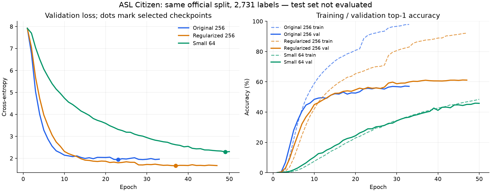

# Completed GRU comparison: 2026-11-10

Both the regularized CV study and queued 64-unit run completed successfully
with exit code 0. The original baseline and all feature caches are preserved.
No test-set evaluation or webcam recognition results are included here.

Subsequently, the validation-selected regularized model was evaluated on the
official test split: **49.92% top-1**, **76.24% top-5**, **49.47% macro F1**.
See [the separate held-out test report](test-evaluation-2026-11-10.md). The
table below remains the validation comparison used before that test.

## Comparable official-split results

All three rows use the same 40,154 official training clips, 10,304 validation
clips, 2,731 labels and prepared feature cache. Select each checkpoint by its
lowest validation cross-entropy, not its highest observed accuracy.

| Model | Parameters | Selected epoch | Train top-1 | Val top-1 | Val top-5 | Val macro F1 | Val loss |
| --- | ---: | ---: | ---: | ---: | ---: | ---: | ---: |
| Original 256-unit baseline | 1,489,835 | 23 | 90.77% | 55.73% | 82.50% | 54.67% | 1.93544 |
| Regularized 256-unit model | 1,489,835 | 37 | 87.60% | **61.06%** | **85.90%** | **60.14%** | **1.65689** |
| Original settings, 64 units | 263,915 | 49 | 47.82% | 45.89% | 76.55% | 44.11% | 2.28733 |

Regularization improves validation top-1 by **5.34 percentage points** and
macro F1 by **5.47 percentage points** relative to the original baseline.
The combined dropout/weight-decay/augmentation candidate was tested as one
package; this experiment does not isolate which component caused the gain.

The 64-unit model is **9.83 percentage points below** the original baseline
in validation top-1. Its smaller training/validation gap does not establish
better recognition: it learned substantially less within this training budget.
Underfitting or slower convergence are plausible explanations. It reached the
50-epoch maximum, without early stopping, and validation top-1 was still
improving overall near the end (43.18% at epoch 41; 45.89% at epoch 49).
These results do not prove that 64 units could never perform better with a
different training budget or configuration.

The regularized model still has a sizeable generalization gap, despite better
validation performance. Training accuracy is accumulated during the changing
model's training pass with dropout (and augmentation for the regularized run),
while validation uses the fixed end-of-epoch model without either. Treat gaps
as diagnostics, not identical clean-train versus clean-validation evaluations.

## Grouped cross-validation results

The three regularized folds use only subsets of official training clips and
different held-out training signers. Do not compare these scores directly
against the official-validation table as if the partitions were identical.

| Fold | Selected epoch | Held-out top-1 | Held-out top-5 | Macro F1 |
| --- | ---: | ---: | ---: | ---: |
| 1 | 27 | 39.11% | 67.57% | 37.56% |
| 2 | 30 | 40.19% | 67.37% | 39.14% |
| 3 | 24 | 35.56% | 63.77% | 33.82% |

Unweighted fold mean +/- sample standard deviation:
top-1 **38.29% +/- 2.42 percentage points**, top-5 **66.24% +/- 2.14 points**,
macro F1 **36.84% +/- 2.73 points**. These are development CV results: the
fold holdouts also select checkpoints. They are not pooled out-of-fold metrics,
confidence intervals, or independent test results. No unregularized CV arm
was run, so the CV mean alone does not quantify a regularization improvement.

## Completion and runtime

- CV folds stopped early after 37, 40 and 34 epochs respectively.
- The regularized official-split refit stopped early after 47 epochs.
- The complete four-stage CV study took about **3 hours 41 minutes**, finishing
  at **01:36:58 on 2026-11-10 Asia/Tashkent**.
- The queued 64-unit run started about three seconds later, at 01:37:01, and
  completed 50 epochs at 03:02:29: about **1 hour 25 minutes**.
- The smaller model averaged about 102.39 seconds per epoch versus 104.90
  for the original baseline. Parameter reduction did not produce a large
  per-epoch speedup on this backend, and its longer run used more total time.

All three selected checkpoints were loaded with `weights_only=True`; their
configurations and epoch metrics match the reports, their weights are finite,
their label maps contain 2,731 entries and their cache IDs match. The original
baseline checksum is unchanged. The refit retained the frozen original CV
engine, preserving the intended experiment when hidden-size support was added.

## Selected models

- Original: `models/asl-gru-128-baseline/best.pt`, epoch 23.
- Best official validation result:
  `models/asl-gru-128-cv-regularized-v1/official-refit/best.pt`, epoch 37.
- Small model: `models/asl-gru-64-baseline/best.pt`, epoch 49.

The regularized checkpoint SHA-256 is
`6e09a1b3c62ea364e2a86b5551eaefe71651332f75fb64a060ed184de7032b39`;
the small checkpoint SHA-256 is
`855ee9692837728cd81db16b6eb5a196f48d0969870f172cc05cfc0d8e17dd97`.

The strongest validation candidate is the regularized 256-unit model. Its
subsequent frozen-checkpoint test evaluation is linked above; other models
have not been evaluated on the test set.
These single-seed development experiments do not establish statistical
significance, unseen webcam performance, continuous recognition, or RSL accuracy.
