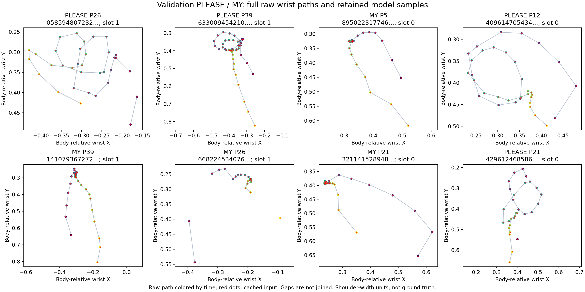
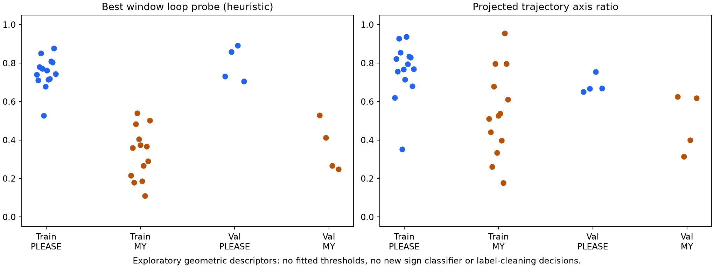

# PLEASE versus MY: bounded source-video and trajectory investigation

The user authorized checking whether PLEASE/MY confusion relates to similar
geometry and loss or underuse of circular motion. This diagnostic does not
resume the stopped corpus audit or cleaning. No training, relabeling, feature
changes, webcam capture or official test access is authorized by this step.

## Protocol recorded before execution

- Examine all available PLEASE/MY training and validation rows: 14/13 training
  and 4/4 validation, 35 source clips total. Keep every example and signer.
- Verify raw archive SHA256/completion metadata and per-member ZIP CRC, record
  identity/class ID, and exact raw-to-prepared equality at float16 precision.
- Fully decode each original source video, checking frame count, shape, FPS
  and recorded byte size; record source SHA256 and preserve it unchanged.
- Compare the canonical dominant hand's full raw body-relative wrist path with
  the retained 128-step model path, using the exact preprocessing and masks.
  Never connect missing detections in a trajectory. Dominant slots are heuristic.
- Compute descriptive path length, extent, endpoint distance, axis ratio,
  turning and closed-polygon circularity. Probe 0.4/0.8/1.2-second contiguous
  windows with fixed formulas; select the strongest geometric loop candidate
  for inspection. These are exploratory shape descriptors, not circle labels
  or a trained classifier. They can respond to jitter, entry/exit or other motion.
- Create 12-frame public-dataset contact sheets for all eight validation clips
  under `.cache/please-my-trajectory-20261112/`, with existing skeleton overlays.
  Inspect those sheets alongside body-relative path plots. Do not publish source
  video frames in the repository; plots/scalar reports go under `docs/assets`.
- Use the already frozen 15-class train/validation predictions. PLEASE is second
  behind MY on all four validation clips for both models. Hypothetically masking
  MY is a diagnostic only, never a deployed rule or fix for the MY class.
- Record checks, findings, uncertainties and scope. Distinguish source integrity,
  preserved movement, estimated joint quality and model decision explanations.

```powershell
.\.venv\Scripts\python.exe scripts/audit_please_my_trajectories.py
```

## Completed checks

All **35** source videos decoded completely with the recorded frame count,
shape, FPS and byte size. Raw archive SHA256 values/completion metadata and
per-member CRC checks passed. Every raw clip normalized back to its cached
features **exactly at float16 precision**. Previous weights, source caches,
raw archives and videos were verified unchanged. No extraction or model
training ran, and the stopped corpus-wide audit was not resumed.

All eight validation clips were under the 128-frame cap: PLEASE lengths were
53, 127, 56 and 69 frames; MY lengths were 80, 124, 56 and 51. Therefore no
validation frames were discarded by this cap. Six training clips were longer
and used the existing endpoint-preserving uniform sampling. Equality checks
confirm this expected sampling, not that every original motion detail survives
downsampling in every long training clip.

The separately reconstructed retained wrist coordinates differed from cached
coordinates by at most **0.000244 shoulder-width units** before float16
quantization. The red retained model samples overlay the raw trajectory plots;
the circular PLEASE paths are still present in the model input.

## Visual and geometric evidence

All eight public-dataset validation contact sheets were reviewed, 12 sampled
frames per clip, with the saved skeleton overlays. In matched P26, P39 and P21
examples, both signs use a similar flat hand near the chest; PLEASE moves
around a loop while MY approaches/holds against the chest. The PLEASE P12
sequence also visibly changes hand position around the chest. These sampled
reviews are consistent with the expected distinction; they are not an expert
annotation of every frame or a certificate that all joint positions are exact.
Some entry/exit frames have motion blur or brief tracking gaps.

The body-relative extracted paths provide quantitative corroboration:

| Validation clip | Full-raw best loop probe | Cached-input best loop probe |
| --- | ---: | ---: |
| PLEASE P26 | 0.731 | 0.730 |
| PLEASE P39 | 0.860 | 0.858 |
| PLEASE P12 | 0.891 | 0.890 |
| PLEASE P21 | 0.705 | 0.705 |
| MY P5 | 0.529 | 0.529 |
| MY P39 | 0.412 | 0.412 |
| MY P26 | 0.267 | 0.266 |
| MY P21 | 0.249 | 0.248 |

The probe favors a projected closed trajectory with nonzero enclosed area.
Its fixed formula/window sizes were recorded before execution; no classifier
or decision threshold was fitted. Validation PLEASE values are higher here,
but **training distributions overlap**: cached PLEASE probes range 0.526-0.877
and MY 0.109-0.540. MY entry/exit motion and tracking variation can also create
loop-like segments. These values must not become a hand-written class-routing
rule selected from the validation results.





## Prediction evidence

Both 15-class models predict MY first and PLEASE second on all four validation
PLEASE clips. Candidate scores, with all 15 classes competing, are:

| PLEASE clip | PLEASE score | MY score |
| --- | ---: | ---: |
| P26 | 20.71% | 78.45% |
| P39 | 48.64% | 49.41% |
| P12 | 23.67% | 75.22% |
| P21 | 14.89% | 84.02% |

These are uncalibrated softmax scores. P39 is nearly tied; the other cases are
more decisively MY. Hypothetically removing MY would make PLEASE first in all
four, which localizes the observed competition but would invalidate recognition
of genuine MY signs. No label was removed or threshold changed.

## Conclusion and next experiment

For these four validation errors, **loss of the circular movement during
extraction/caching or 128-frame sampling is an inadequate explanation**. The
distinguishing trajectory is present, but the current model's decision favors
MY. This supports investigating how the model represents/weights movement
relative to shared flat-hand/chest cues. It does not prove that mean pooling,
a particular hidden layer or the 17-feature geometry branch is the sole cause.
No semantic mislabel or dataset corruption was confirmed.

The current 17 clip summaries include distances, finger angles and excursion
ranges, but no explicit wrist path shape, closed-loop measure or coherent
turning descriptor. A controlled next experiment can add a small set of
trajectory descriptors to that branch while preserving the other settings,
then compare against the frozen 15-class control on validation. The existing
raw/cached landmarks are sufficient for this experiment; no complete MediaPipe
re-extraction is justified by the evidence above. No such model was trained
in this diagnostic step.

## Artifacts and validation

- [Full scalar measurements, video identities and integrity results](assets/please-my-trajectory-2026-11-12.json)
- Trajectory and distribution plots above are saved as standalone PNGs.
- Eight source contact sheets remain local under
  `.cache/please-my-trajectory-20261112/`; no source-video frames were copied
  into tracked documentation or training data.
- Three focused tests passed: synthetic closed-path versus retraced-line
  descriptors, translation/scale invariance, missing-gap handling and explicit
  invalid/stationary input behavior. Synthetic tests validate the formulas,
  not anatomical accuracy on real people.
- The full project check passed **137 tests**, compilation, the offline lockfile
  check and dependency imports. Both exported figures and all eight validation
  contact sheets were visually reviewed. No model/default, source data or
  classification threshold changed, and no Git push or archive update occurred.
