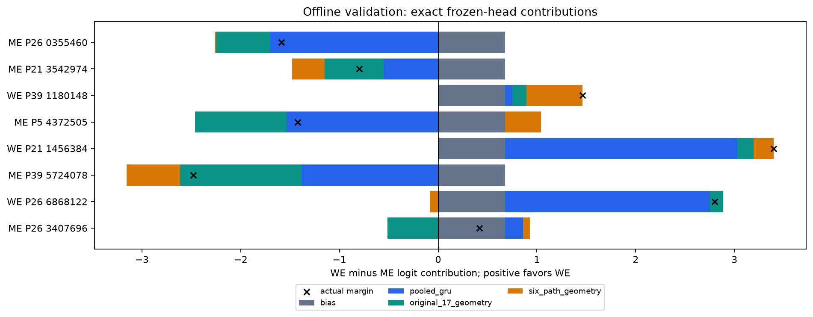
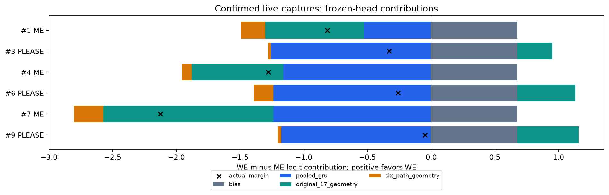

# ME/WE recognition investigation — 2026-11-14

## Protocol and preservation

This implements the agreed diagnosis-only investigation of five user-confirmed
ME-to-WE errors. No model was trained, replaced or made default. No source
videos/features were deleted or relabeled; the stopped corpus audit was not
resumed. The official test split was not read. Existing archive-tool changes
and archives remain preserved.

The frozen current checkpoint SHA256 is
`34b766c393cf20a77b001004376195e60ffb58943d7b1f9661bd23edbab81c91`.
The original temporal comparator SHA256 is
`0921e10a193044e5cbc92e29b386b370b827431b6850f0bc49f6e64ea4441843`.
Their recurrent weights are identical; heads differ. All 15 labels compete.

The audit fully decoded all 37 ME/WE videos (train ME 13, WE 16; validation ME
5, WE 3), verified raw archive hashes/member CRCs, labels/indices, dimensions,
FPS and source sizes, and reproduced every prepared input exactly at float16
precision. All 60 stored validation score vectors reproduce exactly: 54/60
correct, maximum difference 0. Audited video/cache/source/checkpoint/archive
hashes are unchanged after the experiments. Detailed hashes and per-clip data:
[audit JSON](assets/pronoun-investigation-2026-11-14.json).

## Controls and visual review

On each sequence the same 15-class head is explained as four additive terms:
classifier bias, 256 pooled GRU values, 17 original geometry values and six path
values. The WE-minus-ME margin is reconstructed within numerical tolerance.
Three head interventions set standardized feature groups to zero (training
means), without refitting. Reverse, seeded shuffle, repeated middle tracked
frame, anatomical reflection and slot swap all recalculate geometry. Temporal
windows slice the raw observations before normalization and sampling. A changed
guess measures sensitivity; it does not certify a valid preprocessing fix.

Twelve annotated contact sheets were reviewed: all eight validation examples,
both misclassified WE training examples and ME P30/P36 low-visibility examples.
All 37 public-video contact sheets remain local under
`.cache/pronoun-audit-20261114-v1/`; no source images enter Git.
The ME P30/P36 sheets show visible hands near the chest without landmarks in
sampled frames. This is direct evidence of missed tracking in those samples,
not a corpus error rate. These clips can nevertheless be classified correctly.
Front-view occlusion prevents claiming true finger depth/anatomical accuracy.

Offline validation controls (independent transformations, not repairs):

| Control | ME | WE |
| --- | --- | --- |
| original/current | 4/5 | 3/3 |
| original/original_temporal_model | 3/5 | 3/3 |
| reverse_time/current | 3/5 | 3/3 |
| reverse_time/original_temporal_model | 3/5 | 3/3 |
| shuffle_time/current | 5/5 | 3/3 |
| shuffle_time/original_temporal_model | 2/5 | 3/3 |
| static_active_frame/current | 3/5 | 2/3 |
| static_active_frame/original_temporal_model | 3/5 | 2/3 |
| reflect_anatomy/current | 5/5 | 3/3 |
| reflect_anatomy/original_temporal_model | 3/5 | 3/3 |
| swap_hand_slots/current | 3/5 | 0/3 |
| swap_hand_slots/original_temporal_model | 3/5 | 0/3 |
| original_geometry_off | 4/5 | 3/3 |
| path_geometry_off | 4/5 | 3/3 |
| all_geometry_off | 3/5 | 3/3 |
| first_two_seconds | 4/5 | 3/3 |
| detected_hand_envelope | 4/5 | 3/3 |

The failed ME validation video `34076966817997323-ME.mp4` has WE-minus-ME margin
**0.416086**. Components:

| Term | Contribution |
| --- | --- |
| bias | 0.676907 |
| pooled_gru | 0.181102 |
| original_17_geometry | -0.512298 |
| six_path_geometry | 0.070376 |

The six added path descriptors are not necessary for this particular failure:
turning them off leaves WE first. The original geometry favors ME here; the
bias and pooled representation together favor WE. This is an exact decision
explanation for one dataset recording, not yet a cause of the historical live
failures. The geometry summaries do not explicitly encode absolute pointing
direction, but ordered body-relative positions already exist in the GRU input.
Do not claim the input lacks motion or body location.

## Live comparison

Session `pronoun-live-20261114-115103`: 6 user-confirmed captures. Excluded/unconfirmed: 3.

**User correction:** WE was misunderstood in both nine-trial sessions. Captures 2, 5 and 8 are excluded; their actual performed sign is unverified. Earlier WE 1/3 and prefix WE 3/3 claims, and the claimed WE recognition-failure mechanism, are withdrawn. The model response changes remain recorded observations on mislabeled motions, not WE accuracy evidence. [Correction ledger](assets/pronoun-gesture-feedback-correction-2026-11-14.json).

| Control | ME | WE | PLEASE |
| --- | --- | --- | --- |
| full/current | 3/3 | excluded | 3/3 |
| full/original_temporal_model | 3/3 | excluded | 1/3 |
| full/original_geometry_off | 2/3 | excluded | 3/3 |
| full/path_geometry_off | 3/3 | excluded | 1/3 |
| full/all_geometry_off | 2/3 | excluded | 1/3 |
| first_two_seconds/current | 2/3 | excluded | 2/3 |
| first_two_seconds/original_temporal_model | 2/3 | excluded | 1/3 |
| first_two_seconds/original_geometry_off | 2/3 | excluded | 2/3 |
| first_two_seconds/path_geometry_off | 2/3 | excluded | 1/3 |
| first_two_seconds/all_geometry_off | 2/3 | excluded | 1/3 |
| detected_hand_envelope/current | 3/3 | excluded | 3/3 |
| detected_hand_envelope/original_temporal_model | 2/3 | excluded | 0/3 |
| detected_hand_envelope/original_geometry_off | 0/3 | excluded | 3/3 |
| detected_hand_envelope/path_geometry_off | 2/3 | excluded | 0/3 |
| detected_hand_envelope/all_geometry_off | 0/3 | excluded | 0/3 |
| reverse_time | 3/3 | excluded | 3/3 |
| shuffle_time | 2/3 | excluded | 0/3 |
| static_active_frame | 3/3 | excluded | 0/3 |
| reflect_anatomy | 3/3 | excluded | 3/3 |
| swap_hand_slots | 2/3 | excluded | 0/3 |

The protocol is ME, WE, PLEASE three times; four-second automatic captures,
sign once during the first two seconds, then relax. Each capture is tracked
once for recognition; full, first-two-second and detected-hand-envelope views
share those observations. The preview has its own transient tracker. Prefix
and envelope are diagnostic windows, not verified sign boundaries. Prompt
labels are attached after inference and require explicit user confirmation.
Interrupted, failed or user-marked-invalid trials are retained separately.
Only scores, margin contributions, timings and aggregate measurements are
saved—no live video, stills, joint arrays or embeddings.

## Findings and next decision

Established offline: source/cache integrity checks pass; the frozen model's
saved predictions reproduce; sampled detector misses exist; some decisions
change under sequence/slot/orientation controls; classifier terms explain the
failed ME validation clip exactly. None establishes one universal cause of the
five historical live failures, whose coordinates were never saved.

WE recognition conclusions from the live session are withdrawn after the user corrected the gesture labels. ME and PLEASE remain valid (3/3 each in this earlier session). The five historical ME failures and the new instrumented ME trials remain separate evidence. A correctly performed, confirmed WE test is needed before assessing live WE accuracy.

## Software verification

**161 tests passed**, along with lockfile consistency, source compilation and dependency imports. Tests cover numerical margin reconstruction, competitor recovery without embeddings, feature-group boundaries, padding, transformed geometry, timestamps/gaps, raw-before-sampling windows, single-pass recognition tracking, nine-trial lifecycle/errors/interruption, explicit label confirmation and read-only notebook rendering. These checks do not establish general live accuracy.

Runners: `scripts/audit_pronoun_recognition.py`,
`scripts/diagnose_pronouns_live.py`, `scripts/report_pronoun_investigation.py`.
The audit and live runner preserve prior outputs. The report generator refreshes
its own summary/plots; `--live PATH --confirm-all` may be used only after the
user confirms all nine prompts were followed normally. The portable
[summary](assets/pronoun-diagnostic-summary-2026-11-14.json) feeds the reporting
notebooks without opening a camera or executing model inference.
