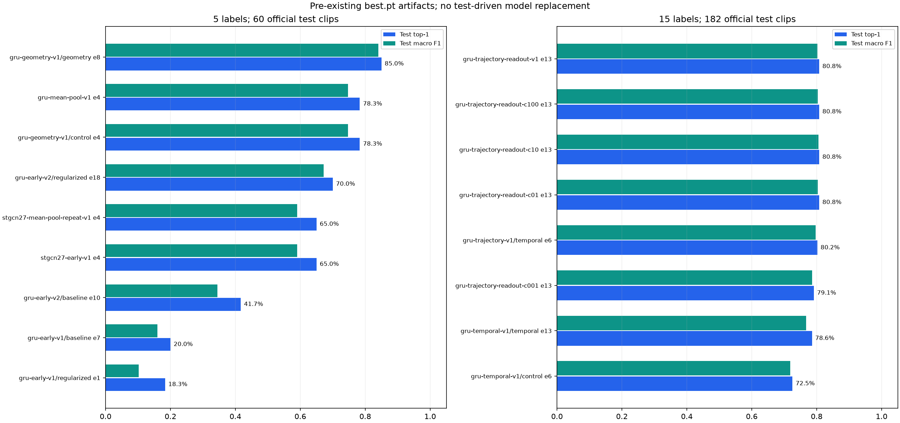
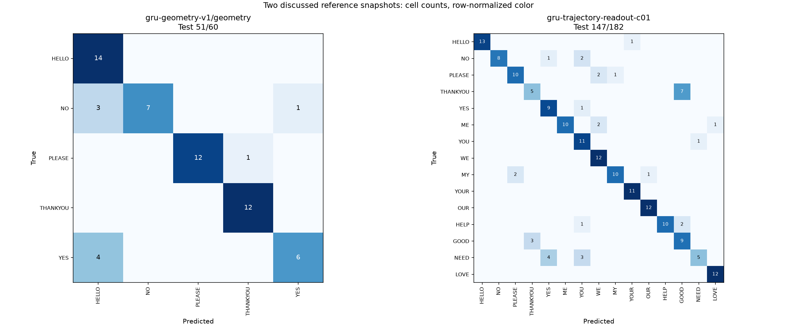

# Frozen five-sign and fifteen-sign test benchmark — 2026-11-14

Completed **152 saved checkpoint paths / 133 byte-distinct checkpoint files**. All per-epoch, `best.pt` and `minimum-val-loss.pt` snapshots in the five-signs/fifteen-signs neural experiment directories were inventoried and hashed before evaluation. Identical files share inference and retain separate alias records. No weights were trained, branches disabled, defaults changed or checkpoint selections replaced.

Each vocabulary uses all of its examples from the official ASL Citizen test split, with the trained label mapping and 128-frame preprocessing. Test signers remain disjoint from the associated training/validation signers. The new inputs were copied into a separate evaluation directory; training caches were preserved. No clip is discarded for missing hands or poor predictions.

Five signs: **60** test clips; fifteen signs: **182**. Parent selected test-feature chunks, cached rows/labels, original subset hashes, runtime source hashes, checkpoints and existing model archives were checked. Protected hashes and selected parent chunks match before/after.

## Pre-existing best.pt artifacts

The following are the pre-existing per-run `best.pt` artifacts. Readout C-grid entries include candidates not chosen as the final model. Their order is a descriptive test comparison, not a new deployment/model-selection decision.

| Classes | Snapshot | Epoch | Test correct | Top-1 | Top-5 | Macro F1 | Cross-entropy |
| --- | --- | ---: | ---: | ---: | ---: | ---: | ---: |
| 5 | `models/asl-gru-five-signs-geometry-v1/geometry/best.pt` | 8 | 51/60 | 85.00% | 100.00% | 0.8407 | 0.4187 |
| 5 | `models/asl-gru-five-signs-geometry-v1/control/best.pt` | 4 | 47/60 | 78.33% | 100.00% | 0.7469 | 0.6377 |
| 5 | `models/asl-gru-five-signs-mean-pool-v1/best.pt` | 4 | 47/60 | 78.33% | 100.00% | 0.7469 | 0.6377 |
| 5 | `models/asl-gru-five-signs-early-v2/regularized/best.pt` | 18 | 42/60 | 70.00% | 100.00% | 0.6724 | 0.7458 |
| 5 | `models/asl-stgcn27-five-signs-early-v1/best.pt` | 4 | 39/60 | 65.00% | 100.00% | 0.5904 | 0.8475 |
| 5 | `models/asl-stgcn27-five-signs-mean-pool-repeat-v1/best.pt` | 4 | 39/60 | 65.00% | 100.00% | 0.5904 | 0.8475 |
| 5 | `models/asl-gru-five-signs-early-v2/baseline/best.pt` | 10 | 25/60 | 41.67% | 100.00% | 0.3446 | 1.2228 |
| 5 | `models/asl-gru-five-signs-early-v1/baseline/best.pt` | 7 | 12/60 | 20.00% | 100.00% | 0.1598 | 1.7271 |
| 5 | `models/asl-gru-five-signs-early-v1/regularized/best.pt` | 1 | 11/60 | 18.33% | 100.00% | 0.1024 | 1.6182 |
| 15 | `models/asl-gru-fifteen-signs-trajectory-readout-c01/best.pt` | 13 | 147/182 | 80.77% | 100.00% | 0.8033 | 0.5242 |
| 15 | `models/asl-gru-fifteen-signs-trajectory-readout-c10/best.pt` | 13 | 147/182 | 80.77% | 99.45% | 0.8058 | 0.6895 |
| 15 | `models/asl-gru-fifteen-signs-trajectory-readout-c100/best.pt` | 13 | 147/182 | 80.77% | 98.35% | 0.8035 | 1.1288 |
| 15 | `models/asl-gru-fifteen-signs-trajectory-readout-v1/best.pt` | 13 | 147/182 | 80.77% | 100.00% | 0.8023 | 0.5462 |
| 15 | `models/asl-gru-fifteen-signs-trajectory-v1/temporal/best.pt` | 6 | 146/182 | 80.22% | 100.00% | 0.7967 | 0.5668 |
| 15 | `models/asl-gru-fifteen-signs-trajectory-readout-c001/best.pt` | 13 | 144/182 | 79.12% | 100.00% | 0.7859 | 0.8075 |
| 15 | `models/asl-gru-fifteen-signs-temporal-v1/temporal/best.pt` | 13 | 143/182 | 78.57% | 100.00% | 0.7679 | 0.6068 |
| 15 | `models/asl-gru-fifteen-signs-temporal-v1/control/best.pt` | 6 | 132/182 | 72.53% | 100.00% | 0.7190 | 0.6740 |

## Highest observed test scores across every stored checkpoint

This includes epochs that were not selected by validation. These are retrospective test leaders, not newly validated deployment choices. Selecting them because of this sweep consumes the test set as selection evidence. Existing best.pt files are preserved.

| Classes | Stored snapshot | Epoch | Correct | Top-1 | Macro F1 |
| --- | --- | ---: | ---: | ---: | ---: |
| 5 | `models/asl-gru-five-signs-geometry-v1/geometry/epoch-005.pt` | 5 | 59/60 | 98.33% | 0.9808 |
| 15 | `models/asl-gru-fifteen-signs-trajectory-readout-c01/best.pt` | 13 | 147/182 | 80.77% | 0.8033 |
| 15 | `models/asl-gru-fifteen-signs-trajectory-readout-c10/best.pt` | 13 | 147/182 | 80.77% | 0.8058 |
| 15 | `models/asl-gru-fifteen-signs-trajectory-readout-c100/best.pt` | 13 | 147/182 | 80.77% | 0.8035 |
| 15 | `models/asl-gru-fifteen-signs-trajectory-readout-v1/best.pt` | 13 | 147/182 | 80.77% | 0.8023 |

## Reference models and class-specific results

### gru-geometry-v1/geometry

| Sign | Correct / support | Recall | Precision | F1 |
| --- | ---: | ---: | ---: | ---: |
| HELLO | 14/14 | 100.00% | 66.67% | 0.8000 |
| NO | 7/11 | 63.64% | 100.00% | 0.7778 |
| PLEASE | 12/13 | 92.31% | 100.00% | 0.9600 |
| THANKYOU | 12/12 | 100.00% | 92.31% | 0.9600 |
| YES | 6/10 | 60.00% | 85.71% | 0.7059 |
### gru-trajectory-readout-c01

| Sign | Correct / support | Recall | Precision | F1 |
| --- | ---: | ---: | ---: | ---: |
| HELLO | 13/14 | 92.86% | 100.00% | 0.9630 |
| NO | 8/11 | 72.73% | 100.00% | 0.8421 |
| PLEASE | 10/13 | 76.92% | 83.33% | 0.8000 |
| THANKYOU | 5/12 | 41.67% | 62.50% | 0.5000 |
| YES | 9/10 | 90.00% | 64.29% | 0.7500 |
| ME | 10/13 | 76.92% | 100.00% | 0.8696 |
| YOU | 11/12 | 91.67% | 61.11% | 0.7333 |
| WE | 12/12 | 100.00% | 75.00% | 0.8571 |
| MY | 10/13 | 76.92% | 90.91% | 0.8333 |
| YOUR | 11/11 | 100.00% | 91.67% | 0.9565 |
| OUR | 12/12 | 100.00% | 92.31% | 0.9600 |
| HELP | 10/13 | 76.92% | 100.00% | 0.8696 |
| GOOD | 9/12 | 75.00% | 50.00% | 0.6000 |
| NEED | 5/12 | 41.67% | 83.33% | 0.5556 |
| LOVE | 12/12 | 100.00% | 92.31% | 0.9600 |

## Every stored epoch and alternate snapshot

The [complete CSV](assets/small-vocab-snapshot-test-2026-11-14.csv) has one row for every saved path, including all epochs and minimum-validation-loss alternatives. The [portable JSON](assets/small-vocab-snapshot-test-2026-11-14.json) contains all unique-checkpoint metrics, aliases, confusion matrices, per-class scores and per-signer scores. Full per-video probability vectors are recorded under `data/evaluations/small-vocab-snapshot-test-2026-11-14-v1/checkpoints/<hash>/predictions.jsonl`, with companion per-class/confusion CSVs and reports.

## Interpretation limits

- Five- and fifteen-label tasks have different chance levels and samples; rank within vocabulary.
- Five-class top-five is automatically 100%, not discriminative.
- All saved epochs are retrospective test comparisons; existing validation selections stay unchanged.
- Historical full-vocabulary experiments already used these official test signers/videos; no claim of a newly sealed holdout.
- Dataset test scores do not establish webcam accuracy.

These are original official partitions, not a newly drawn random 80/20 split. Five-label and fifteen-label accuracies are different tasks. The snapshot sweep is retrospective; future changes informed by it need fresh validation/holdout evidence. An earlier perfect ten-attempt webcam session does not override the larger dataset test, and strong dataset results do not establish live-camera recognition.

## Reproduction and verification

`python scripts/benchmark_small_vocab_snapshots.py --output data/evaluations/NEW_EMPTY_RUN` freezes inventory before test evaluation. `python scripts/report_small_vocab_benchmark.py --evaluation RUN` renders this record without inference or weight changes.

Hardware: NVIDIA GeForce RTX 4060. Inference/output and final integrity checks took 78.8 seconds after input preparation. Focused evaluator tests passed before the run. The reporting notebook includes these frozen test results.

## Final verification

All **183 tests passed**. Every per-video prediction reconstructs its saved confusion matrix; historical five-sign GRU/ST-GCN test confusions reproduce exactly. Official CSV hashes and all 375 protected checkpoint/config/cache/source/archive hashes match after the test suite. See [verification record](assets/small-vocab-snapshot-test-verification-2026-11-14.json).
