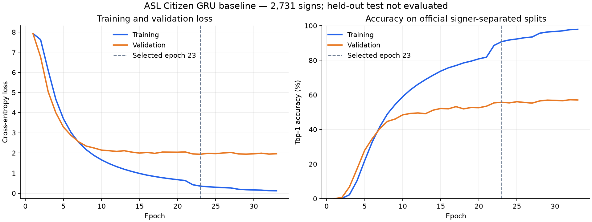

# First completed ASL Citizen GRU baseline

The corrected local CUDA run completed successfully on 2026-11-09 with exit
code 0. It ran from 20:36:20 to 21:34:12 Asia/Tashkent: about **57 minutes
51 seconds**, including startup and checkpoint overhead.

## Protocol and checkpoint selection

- ASL Citizen, 2,731 labels; official signer-separated splits.
- Training: 40,154 clips. Validation: 10,304 clips.
- The 32,941-clip test split has **not** been evaluated.
- Two-layer unidirectional GRU, 256 hidden units, 254 input features per frame,
  maximum 128 frames, linear classifier, dropout 0.3, batch size 64.
- CUDA AMP on the RTX 4060, using the ATen CUDA RNN path with cuDNN disabled.
- AdamW and cross-entropy, no augmentation in this initial baseline.
- Select the lowest validation cross-entropy; stop after 10 epochs without
  a lower validation loss, with a maximum budget of 50 epochs.

Training stopped after **epoch 33**. The selected model is **epoch 23**,
not the final epoch. Its checkpoint is
`models/asl-gru-128-baseline/best.pt`.

## Selected checkpoint results

All recognition metrics below are **validation** results, not test or webcam
accuracy. Values are for the same selected epoch-23 checkpoint.

| Metric | Value |
| --- | ---: |
| Validation top-1 accuracy | 55.73% |
| Validation top-5 accuracy | 82.50% |
| Validation macro precision | 59.60% |
| Validation macro recall | 56.36% |
| Validation macro F1 | 54.67% |
| Validation weighted F1 | 54.51% |
| Validation cross-entropy | 1.93544 |
| Training top-1 accuracy | 90.77% |
| Training cross-entropy | 0.35250 |

Top-5 means the true label appears among five predictions; it does not mean
the first displayed label is correct 82.5% of the time. Macro metrics average
the 2,731 class-level scores equally. Training metrics are collected during
the evolving training pass with dropout active, while validation uses the
fixed end-of-epoch model with dropout disabled.

The highest recorded validation top-1 was **57.19% at epoch 32**, but that
epoch's loss (1.94276) was higher than epoch 23's. It was not selected under
the declared loss-based rule, and no separate epoch-32 weights were saved.
`last.pt` contains epoch 33 (validation top-1 57.03%, loss 1.95763).

## Learning behavior and reliability

The model learns sign-discriminating patterns, but there is a substantial
generalization gap: training accuracy continues to rise while validation
accuracy levels off around 55–57%. The curves are consistent with overfitting.
These results do not establish accuracy on a new webcam user, continuous
signing, unknown signs, RSL, or sentence translation.

The run completed **33 full training and validation passes**, averaging
104.90 seconds (about 1 minute 45 seconds) per epoch. The logged epoch total
is 3,461.861 seconds; supervisor wall time is slightly longer. Six AMP
optimizer updates were skipped safely after overflow; training reduced the
gradient scale and continued. There were no fatal errors in the corrected
run and its stderr log is empty. Peak allocated CUDA memory was 287,693,824
bytes (about 274 MiB), excluding CUDA context, allocator reserves and other apps.

The selected checkpoint was loaded with `weights_only=True`; its epoch,
configuration and metrics match the saved epoch record, all weights are
finite, and its label map contains 2,731 entries. Checkpoint size:
6,017,813 bytes (about 6.02 MB). SHA-256:
`c2598b620f1dbb5e2d51ba8b4d195f3d1868e473decf6b36567e9b53e6186b10`.

## Artifacts and next evaluation

Raw records remain under `models/asl-gru-128-baseline/`: `config.json`,
`labels.json`, `epoch-001.json` through `epoch-033.json`, `status.json`,
`best.pt` and `last.pt`. Supervisor state/logs are in `.cache/training/`,
with attempt prefix `20261109T153620Z`. Model/runtime files remain ignored
by Git. The failed initial cuDNN attempt is preserved separately and is not
included in these results.

Next, freeze the selected epoch-23 checkpoint and evaluate it on the untouched
official test split. Use validation for further model or augmentation changes.
A separate guided webcam evaluation is needed to measure application behavior.
Final presentation metrics still require the planned separate discussion.
