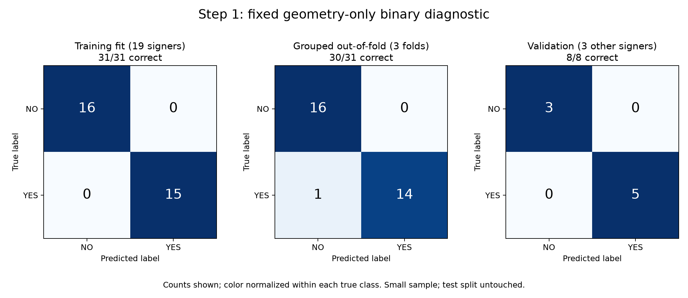

# Step 1: fixed YES/NO geometry diagnostic

The user authorized proceeding step by step. This first experiment isolates
whether explicit hand-shape and motion-excursion summaries can distinguish NO
from YES. It does not change or replace the existing five-sign recognizers.

## Prespecified protocol

- Source: unchanged five-sign cache, NO/YES rows only, retaining official splits:
  **16 NO + 15 YES training clips (19 signers)** and **3 NO + 5 YES validation
  clips (3 other signers)**. Official test examples are not loaded or scored.
- Use the 17 existing scalar measurements: thumb/index/middle XY/XYZ gaps and
  gap ranges, fingertip/wrist distances, finger PIP angles and angle ranges,
  palm-axis excursions and body-relative wrist excursion.
- These include detected rest and dominant-slot estimation; they are not
  ground-truth joints. Motion is summarized as excursion, not timestamp-calibrated
  velocity. No re-extraction, new webcam capture or new live coordinates.
- Fixed CPU pipeline: median imputation fitted on training only, optional
  missingness indicators, standardization, logistic regression C=1 / lbfgs /
  max_iter=2000 / seed 42. No tuning, class weighting or label-dependent routing.
- Three signer-grouped training-only folds, each fitting its own imputer/scaler
  and classifier. Grouped CV estimates robustness; it is not regularization.
- Then fit the fixed pipeline on all 31 training clips and evaluate the eight
  official validation clips. Preserve all individual decisions and confusion
  matrices; do not choose hyperparameters from these results.
- After freezing the model, optionally score four previously confirmed NO/YES
  **scalar summaries**. They influenced this diagnostic's design, so this is
  retrospective evidence, not a fresh live benchmark or model-selection set.
- Separate artifact: `models/asl-yes-no-geometry-diagnostic-v1/model.pkl` with
  source/version/config records. This binary classifier can only choose NO/YES
  and is not an unknown-sign detector or a five-class application replacement.

```powershell
.\.venv\Scripts\python.exe scripts/run_yes_no_geometry_diagnostic.py
```

## Results

The fixed classifier completed on CPU without parameter search:

| Evaluation | Correct | Accuracy | Macro F1 |
| --- | ---: | ---: | ---: |
| Fit on all training clips | 31/31 | 100% | 1.0000 |
| Training-only, signer-grouped out-of-fold | 30/31 | 96.77% | 0.9676 |
| Official validation, three other signers | 8/8 | 100% | 1.0000 |

The out-of-fold mistake was one YES predicted as NO. Validation recognized all
three NO and all five YES clips. No selected clip was excluded as insufficient;
none of the selected metric values required imputation. Per-fold signer IDs,
row assignments, errors and all individual predictions are preserved in the
[machine-readable report](assets/yes-no-geometry-diagnostic-2026-11-12.json).

The held-out folds contained 11, 11 and 9 clips from 8, 6 and 5 signers,
respectively; correct counts were 11, 10 and 9. The misclassified example was
`15498675309554577-YES.mp4`, participant P11. This is a classifier error flag,
not a claim that the clip or its annotation is defective.



After the final model was frozen, it also correctly classified the four old
confirmed live summaries: captures 1 and 4 as NO, captures 2 and 5 as YES. Those
summaries were previously inspected when designing this diagnostic, so **4/4
is retrospective evidence, not an independent webcam result**. No new camera
capture took place.

## Interpretation and limits

These results show that this representation retains useful YES/NO differences
in the sampled clips, including the earlier live examples. Complete loss of
distinguishing hand information is therefore an inadequate explanation for
those four errors. This does not establish that every landmark is accurate,
that the sequence models cannot learn the difference, or that a specific
layer is responsible. A binary task also removes competition with HELLO,
PLEASE and THANKYOU, so its accuracy cannot be compared directly with the
five-class models' accuracy.

The validation set contains only eight clips from three signers. The probe
cannot recognize another sign or reject an unknown input. It has not been
connected as a five-class router, and no claim of a completed application fix
is made. A later controlled five-class experiment can test adding explicit
hand geometry; that is outside this first step.

All existing `best.pt` weights and eight train/validation cache files were
SHA256-verified unchanged before and after execution. Official test data was
not loaded. Main recognizers and defaults remain unchanged. The separate
diagnostic model is local at
`models/asl-yes-no-geometry-diagnostic-v1/model.pkl` (load only trusted pickle
files), with configuration, source snapshot and report alongside it. It was
created after the previous model archive and is not included in that archive.

Environment: Python 3.12.6, NumPy 1.26.4, scikit-learn 1.9.1. Reproduce the
figure without training using:

```powershell
.\.venv\Scripts\python.exe scripts/plot_yes_no_geometry_diagnostic.py
```

## Verification

`scripts/check.ps1` passed: offline lockfile check, source compilation, all
112 unit tests, and dependency imports. Four focused tests verify the fixed
geometry schema, train-only imputation/scaling, signer separation with one
out-of-fold prediction per row, and binary confusion-matrix label order. The
PNG was rendered and visually reviewed. These checks validate the experiment's
implementation; they are not a new webcam recognition test.
